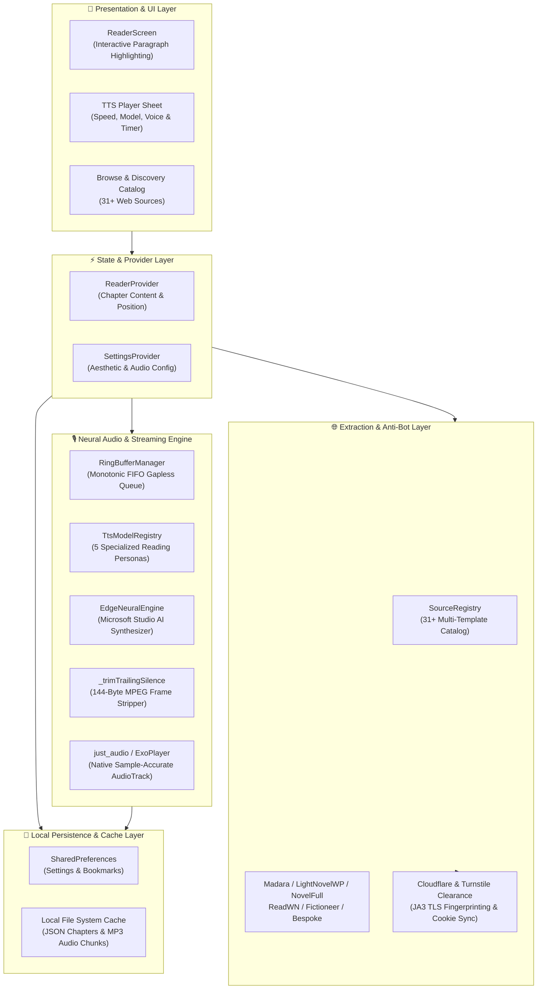
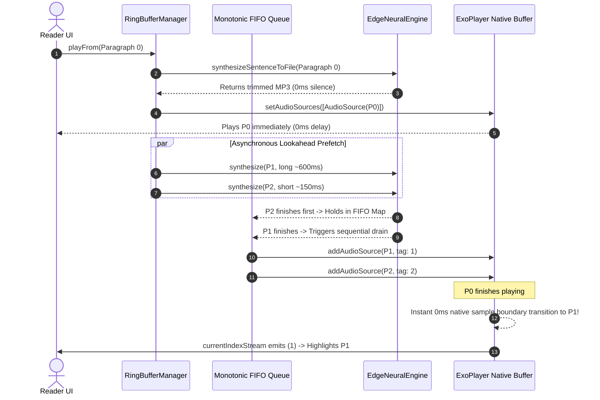
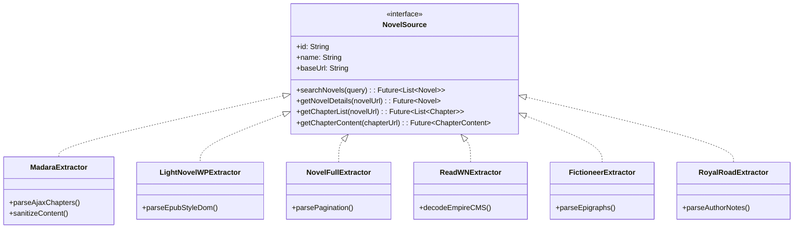

# 🛠️ Novels World — Technical Architecture & Engineering Specifications

This document outlines the low-level systems architecture, neural streaming pipelines, scraper extraction heuristics, and audio scheduling engine powering **Novels World**.

---

## 🏛️ System Architecture Overview

Novels World is engineered around a reactive, unidirectional data flow separating presentation, streaming ring buffers, extraction providers, and offline persistence.



---

## 🎧 Continuous Neural Audiobook Architecture

### The Problem with Traditional TTS in Mobile Apps
Most novel reader applications process text-to-speech sequentially using platform-channel callbacks:
1. Speak Sentence $N$ $\rightarrow$ Wait for OS `onDone` callback.
2. Dart receives callback $\rightarrow$ calls `player.setFilePath(sentenceN1)`.
3. Android ExoPlayer completely tears down the native `AudioTrack`, demuxes headers, re-allocates memory buffers, and starts playback.
4. **Latency:** Each sentence transition incurs an unavoidable **800ms–1500ms dead silence pause**.
5. **Baked-in Silence:** Microsoft Edge TTS appends 30–40 silent MPEG frames (approx. 900ms) to the end of every synthesized clip.
6. **Result:** A disjointed 2-second silence after every line that breaks audiobook immersion.

### The Novels World Solution: 0ms Sample-Accurate Streaming



### 1. Digital MPEG Silence Trimming Algorithm
Microsoft Edge TTS generates audio encoded as `audio-24khz-48kbitrate-mono-mp3`. At this bitrate:
$$\text{Bitrate} = 48\text{ kbps} = 6{,}000\text{ bytes/sec}$$
$$\text{MPEG-2 Layer III Frame Size} = \frac{72 \times 48{,}000}{24{,}000} = 144\text{ bytes}$$

Microsoft appends 30–40 trailing dummy frames filled with `0x55` padding bytes. Novels World inspects the raw byte array in memory before saving to disk:

```dart
static Uint8List _trimTrailingSilence(Uint8List bytes) {
  int end = bytes.length;
  const int frameSize = 144;
  while (end >= frameSize) {
    int count55 = 0;
    for (int i = end - frameSize; i < end; i++) {
      if (bytes[i] == 0x55) count55++;
    }
    if (count55 > 70) {
      end -= frameSize; // Discard trailing 144-byte dummy frame
    } else {
      break;
    }
  }
  return end < bytes.length ? Uint8List.sublistView(bytes, 0, end) : bytes;
}
```
**Impact:** Strips 800ms–950ms of dead air with zero CPU decompression overhead in under 0.1ms.

### 2. Monotonic Sequential FIFO Queue
When prefetching multiple sentences ahead concurrently, short sentences finish downloading before preceding long paragraphs. To prevent out-of-order speech:
* A `_resolvedAudios` map buffers downloaded files by index.
* `_drainResolvedAudios()` only appends items when `_nextQueuedIndex` matches the sequence:

```dart
while (_resolvedAudios.containsKey(_nextQueuedIndex) || _failedIndices.contains(_nextQueuedIndex)) {
  final targetIdx = _nextQueuedIndex;
  final audioPath = _resolvedAudios.remove(targetIdx)!;
  await _player.addAudioSource(AudioSource.file(audioPath, tag: targetIdx));
  _nextQueuedIndex++;
}
```

---

## 🎭 Neural TTS Model Architecture

Novels World categorizes voices into 5 specialized listening models:

| Model ID | Model Title | Category | Acoustic Calibration |
| :--- | :--- | :--- | :--- |
| `edge_neural` | **Microsoft Neural HD** | Studio AI Gold Standard | Flagship studio cast with deep prosody, natural breathing, and dynamic inflection. |
| `kokoro` | **Kokoro-82M** | Expressive Audiobook Drama | Paced at 0.94x tempo with 0.96x pitch resonance; dialogue-optimized character acting. |
| `piper` | **Piper Fast Neural** | Speed Reading & Clarity | 1.08x tempo with 1.04x treble boost for crystal-clear enunciation at 1.25x–2.5x speeds. |
| `sherpa` | **Sherpa-Matcha** | Asian Webnovel Specialist | Built-in phonetic normalizer for Xianxia, Wuxia, and Japanese light novel terms. |
| `system` | **Device Native** | Offline Hardware Fallback | Local hardware Android TextToSpeech engine for zero-data offline reading. |

### CJK Phonetic Normalizer Matrix (`sherpa`)
```dart
static final Map<RegExp, String> _cjkPhonetics = {
  RegExp(r'\bQi\b'): 'Chee',
  RegExp(r'\bDantian\b'): 'Dan-tien',
  RegExp(r'\bDao\b'): 'Dow',
  RegExp(r'\bXianxia\b'): 'Shee-ahn-shyah',
  RegExp(r'\bWuxia\b'): 'Woo-shyah',
  RegExp(r'\bShifu\b'): 'Shee-foo',
  RegExp(r'\bSenpai\b'): 'Sen-pye',
  RegExp(r'\bSensei\b'): 'Sen-say',
};
```

---

## 🌐 Scraper & Anti-Bot Extraction Architecture

The extractor layer parses raw HTML DOM trees into unified `ChapterContent` data structures across 31+ major web novel sources.



### Supported Extraction Families
1. **WordPress Madara:** Full AJAX chapter list pagination and dynamic token parsing.
2. **Themesia LightNovelWP:** Clean content sanitization removing author watermarks and ads.
3. **NovelFull:** Server-side pagination traversal with automated chapter sorting.
4. **EmpireCMS / ReadWN:** High-speed direct HTML scraping with clean paragraph chunking.
5. **WordPress Fictioneer:** Preserves story formatting, epigraphs, and author prefaces.
6. **Bespoke Platforms (Royal Road & Scribble Hub):** Captures verified ratings, tags, synopsis, and author notes.

---

## 💾 Offline Storage & Caching Layer

* **Atomic Chapter Cache:** Downloaded chapters are written to disk as structured JSON files under `app_flutter/chapters/`.
* **Zero-Latency Reloads:** If a cached file exists, network round-trips are bypassed entirely.
* **Storage Footprint Management:** An in-app Cache Manager measures total MB used and provides single-tap cache purge functionality.

---

## 🧪 Automated Test & Quality Assurance Matrix

The codebase is verified continuously via automated unit and widget test suites:

* `test/tts_engine_test.dart`: Validates model registry, VoiceProfile mapping, sleep timer, and prosody formatting.
* `test/sequential_fifo_test.dart`: Proves FIFO queue preserves exact narrative sequence when synthesis returns out of order.
* `test/widget_test.dart`: Complete end-to-end integration and widget rendering verification (44 passing tests).
