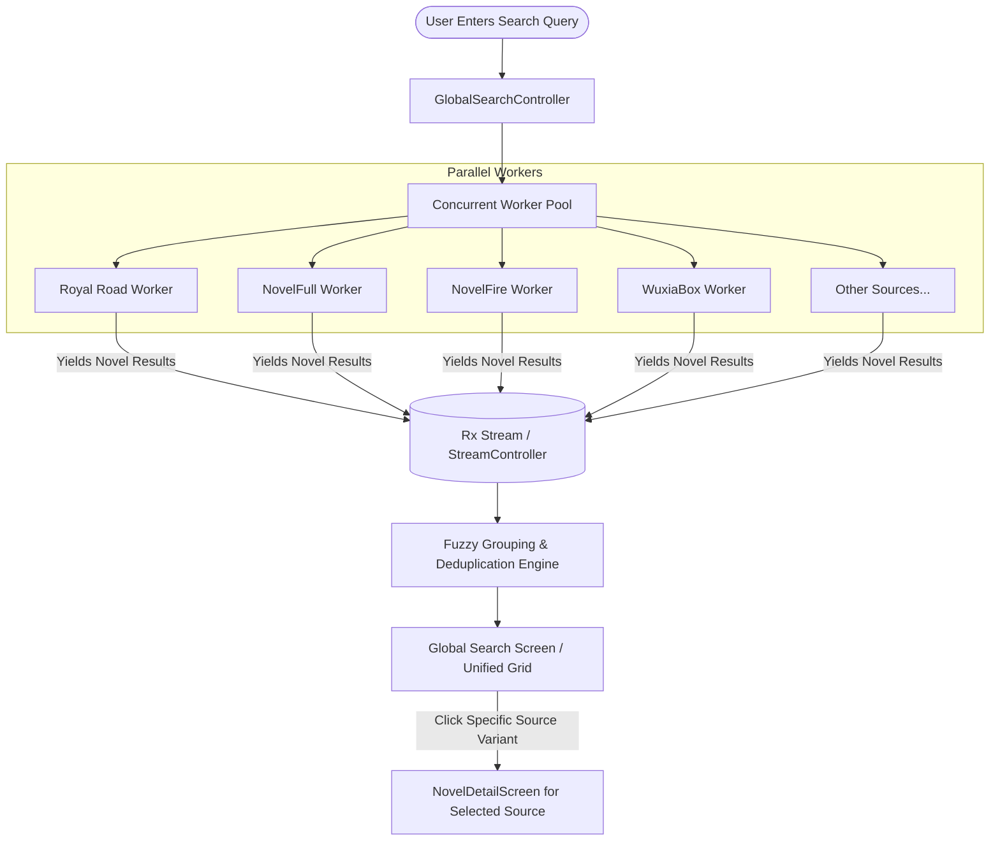
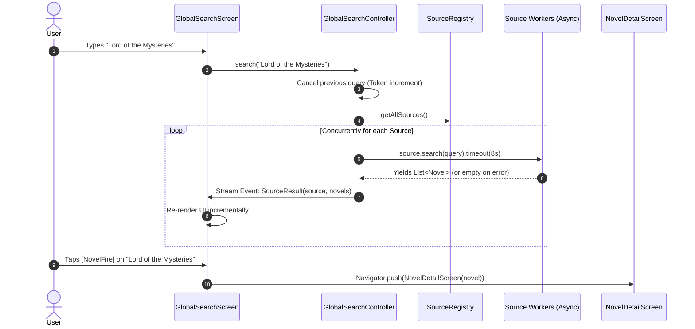

# Global Multi-Source Search: Architecture & Execution Plan

## 1. Executive Summary & Problem Statement

### 1.1 The Challenge
Currently, users searching for a novel must manually select a source from the dropdown, execute a search query, wait for results, and repeat this process across 20+ sources (NovelFull, NovelFire, Royal Road, ScribbleHub, WuxiaBox, LightNovelWP, etc.) if their desired title is missing or has incomplete chapters.

### 1.2 The Solution: "Global Search"
A unified, parallel search engine that simultaneously queries all active sources in the catalog, streams results to the user as each source responds, groups duplicate novel titles across sources, and allows one-tap navigation to the exact novel page in that specific source.



---

## 2. Core Functional Requirements

1. **Simultaneous Multi-Source Dispatch**:
   - Query all registered sources (`SourceRegistry.getAllSources()`) concurrently using Dart's asynchronous futures.
2. **Incremental Reactive Streaming**:
   - The UI must **not** block until all 20+ sources finish. Results must stream incrementally into the list/grid in real time as each individual source completes (within 300ms–2.5s).
3. **Dual View Presentation**:
   - **Grouped View (Default)**: Aggregates the same novel (e.g. *Shadow Slave*) found across multiple sources into a single master card with interactive source pills/badges showing availability (e.g. `[NovelFire]`, `[NovelFull]`, `[ReadWN]`).
   - **By-Source View (Tab 2)**: Categorizes results by source section with count badges (e.g., *NovelFire (12)*, *Royal Road (4)*).
4. **Direct Navigation**:
   - Tapping any source badge or card immediately opens [`NovelDetailScreen`](file:///home/adityapatra/Documents/GitHub/Novels-World/lib/ui/novel_detail/novel_detail_screen.dart) populated with the exact novel ID, source URL, cover, and extractor.
5. **Robust Fault Tolerance & Circuit Breaking**:
   - If one source times out, fails with a 404, or hits Cloudflare, it is isolated. It must **never** break or delay results from other healthy sources.
6. **Query Cancellation & Debounce**:
   - When the user modifies the search term, ongoing HTTP requests and parsing tasks for the previous query must be cancelled or invalidated via a Generation ID token.

---

## 3. Architecture & State Management

### 3.1 Data Flow Model



### 3.2 Domain Models

```dart
/// Represents the result emitted by a single source during a global search session.
class SourceSearchResult {
  final NovelSource source;
  final List<Novel> novels;
  final bool isSuccess;
  final String? errorMessage;
  final Duration elapsed;

  const SourceSearchResult({
    required this.source,
    required this.novels,
    required this.isSuccess,
    this.errorMessage,
    required this.elapsed,
  });
}

/// Represents a canonical novel clustered across multiple sources.
class GroupedNovelMatch {
  final String canonicalTitle;
  final String author;
  final String? coverUrl;
  final Map<NovelSource, Novel> sourceVariants;

  GroupedNovelMatch({
    required this.canonicalTitle,
    required this.author,
    this.coverUrl,
    required this.sourceVariants,
  });
}
```

---

## 4. UI/UX Design

### 4.1 Global Search Screen Wireframe

```
+-------------------------------------------------------------+
|  <-  [Search novel across all sources...           ]  (X)   |
+-------------------------------------------------------------+
|  Active Sources: 14/14  |  Found: 28 novels  | [=== 100% ==] |
+-------------------------------------------------------------+
|  [All Languages (EN)]  [Grouped (Auto)]  [By Source View]   |
+-------------------------------------------------------------+
|  +-------------------------------------------------------+  |
|  | [COVER]  Shadow Slave                                 |  |
|  |          Author: Guiltythree                          |  |
|  |          Available in 4 Sources:                      |  |
|  |          [NovelFire ->] [ReadNovelFull ->] [NovelFull] |  |
|  +-------------------------------------------------------+  |
|  +-------------------------------------------------------+  |
|  | [COVER]  Lord of the Mysteries                        |  |
|  |          Author: Cuttlefish That Loves Diving        |  |
|  |          Available in 3 Sources:                      |  |
|  |          [NovelFull ->] [NovelFire ->] [WuxiaBox ->]  |  |
|  +-------------------------------------------------------+  |
|  +-------------------------------------------------------+  |
|  | [COVER]  Mother of Learning                           |  |
|  |          Author: nobody103                            |  |
|  |          Available in 2 Sources:                      |  |
|  |          [Royal Road ->] [NovelBin ->]                |  |
|  +-------------------------------------------------------+  |
+-------------------------------------------------------------+
```

### 4.2 Key UI Components

1. **Live Source Progress Header**:
   - A sleek horizontal progress bar indicating completed sources (`7/14 sources finished`).
   - Pulsing badges showing active searches vs completed searches.
2. **Interactive Source Availability Chips**:
   - Each card prominently displays colored chips for each source hosting that book.
   - Clicking a chip opens that exact source’s version of the novel.
3. **Empty & Edge State Handling**:
   - Graceful placeholders when queries are too short (< 2 chars).
   - "No matches found across X sources" with a recommendation to check novel title spelling.
4. **Recent Searches & Suggestions**:
   - Cache recent search queries locally via `SharedPreferences`.

---

## 5. Execution Roadmap

| Phase | Milestone | Deliverables | Target Status |
| :--- | :--- | :--- | :--- |
| **Phase 1** | **Controller & Concurrency Engine** | Create `GlobalSearchController` with streams, timeout isolation, cancellation generation tokens, and fuzzy clustering engine. | Ready for implementation |
| **Phase 2** | **UI Implementation** | Create `GlobalSearchScreen`, `GlobalNovelCard`, and source switcher chips with responsive layout. | Ready for implementation |
| **Phase 3** | **Navigation Integration** | Connect Global Search into `BrowseScreen` and `HomeScreen` search actions. | Ready for implementation |
| **Phase 4** | **Testing & Verification** | Add automated unit tests for concurrency, deduplication, error isolation, and verify live on emulator. | Ready for implementation |

---

## 6. Verification & Quality Assurance Strategy

1. **Concurrency Benchmark**:
   - Verify that 15 sources are queried in parallel in `< 3.5 seconds` on mobile network conditions.
2. **Error Isolation Test**:
   - Mock 5 sources throwing 403 / 500 errors and verify that the remaining 10 sources render their novels cleanly with zero UI exceptions.
3. **Fuzzy Deduplication Test**:
   - Verify that `"Shadow Slave"` from NovelFire and `"Shadow Slave (Web Novel)"` from NovelFull cluster together into 1 card with 2 source badges.
4. **Widget Tests**:
   - Test search cancellation on rapid typing debouncing.
   - Test navigation intent triggering `NovelDetailScreen`.
