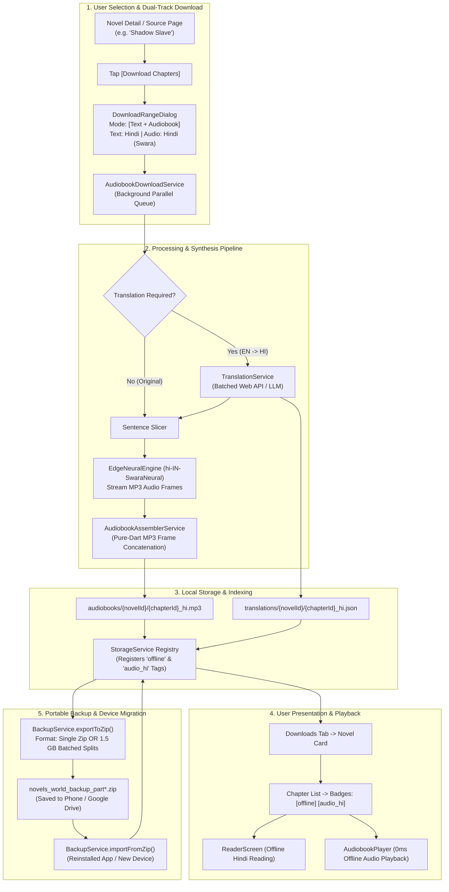

# Engineering Plan: Offline Audiobook Ecosystem, In-Reader Translation, Audio Cache Assembly & Portable .ZIP Migration

> **Document**: `plan.md`  
> **Status**: Approved Production Architecture & UI/UX Design  
> **Target Platforms**: Android, iOS, Web, Desktop (Linux/Windows/macOS)  
> **Scope**: Advanced Dual-Track Downloader, In-Reader Live Translation (`Icons.translate`), Zero-FFmpeg MP3 Frame Concatenation, "Listen-to-Save" Audio Cache Assembly, Downloads Tab Multi-Tag Badging (`offline`, `audio_hi`), Dedicated Audiobook Player, Narrator Audition Gallery, and 1-Click Portable `.zip` Backup & Migration (Single Monolithic or 1.5 GB Batched Splits).

---

## 1. Executive Summary & User Story

### The Problem
Previously, reading and downloading in novel apps was rigidly one-dimensional:
1. **Language Barrier**: If an English reader wanted to read a raw Japanese light novel, or a reader fluent only in **Hindi** wanted to read an English novel like *Shadow Slave*, they had no way to translate the chapter text or listen to it in their native tongue.
2. **Ephemeral Audio**: When using Text-to-Speech (TTS), audio chunks were streamed and discarded after listening. Users could not retain the audio or download complete offline audiobooks for their commute or flights.
3. **App Deletion / Device Migration Fear**: If a user reinstalled the app, cleaned phone storage, or bought a new phone, all downloaded chapters and reading progress were permanently lost.

### The Solution: A Complete, User-Friendly Audio & Reading Ecosystem
This plan introduces a cohesive, intuitive feature set designed specifically for everyday, non-technical readers:
- **1-Tap Dual-Track Downloader**: When downloading chapters (e.g. *Shadow Slave* Ch 1–10), the user can effortlessly choose their preferred text language (e.g. Hindi), check `[🎧 Download Audio too]`, choose the voice, and download both text and studio-grade audio in one go.
- **In-Reader Translation Symbol (`Icons.translate`)**: Tapping the translation button in the top app bar immediately pops up a clean, completely unbiased **Language Selection Modal** with search and native scripts. The user can freely choose any target language from 70+ global languages, and the chapter text immediately translates with synchronized native voice speech highlighting.
- **"Listen-to-Save" Audio Assembly**: Listening to TTS while reading automatically retains and stitches the audio into permanent chapter `.mp3` audiobooks.
- **Downloads Tab Badging**: In the Downloads tab, chapters clearly display colorful badges: **`[offline]`** for text and **`[audio_hi]`** for Hindi audio (or `audio_en`, `audio_es`, etc.).
- **Narrator Audition Gallery**: Users can browse and tap `[▶ Play Sample]` on every narrator before choosing one for bulk downloads.
- **1-Click Portable `.zip` Backup & Migration**: An Export/Import window packages all novels, chapters, audiobooks, and progress into structured `.zip` files (either in 1 file or in 1.5 GB split batches) saved to phone storage. Reinstalling the app and picking the `.zip` file(s) instantly restores everything.

---

## 2. Industry App Benchmarks & Reference Standards

To ensure a world-class user experience and avoid reinventing flawed patterns, our architecture adopts proven architectural designs from industry-leading applications:

| Benchmark App | Adopted Architectural Pattern | How Novels-World Implements It |
| :--- | :--- | :--- |
| **Audible / Storytel** | **Continuous Gapless Audio & Smart Rewind** | Zero-latency local MP3 playback without sentence stutter; remembers millisecond position with 2-second "smart rewind" on resume to restore reader context. |
| **Audible** | **Smart Volume Fade Sleep Timer** | Gradual 45-second audio attenuation (fade-out) before pausing, preventing jarring wake-ups. |
| **Mihon / Tachiyomi** | **Split-Volume Non-Destructive Backup** | 1.5 GB split volume archives with atomic boundary safety; strictly read-only export leaving running databases untouched; pre-restore manifest validation. |
| **Mihon / Tachiyomi** | **Clear File Destination Feedback** | Post-export dialog displaying absolute file path, file size cards, instant `[📋 Copy Path]`, and Android `Intent.ACTION_VIEW` / `[📂 Open in Files]`. |
| **Moon+ Reader / Legado** | **Unbiased On-Device Translation Caching** | Permanent disk caching in `translations/{novelId}/{chapterId}_{lang}.json`; 0 network calls for re-reads; bilingual long-press tooltip. |
| **Pocket Casts / Spotify** | **Persistent Floating Mini-Player & Media Controls** | Docked bottom mini-player expanding to full-screen player; Android `MediaSession` & iOS `MPRemoteCommandCenter` lockscreen notifications. |

---

## 3. Defensive Architecture: Blunder Prevention Matrix

To eliminate the risk of failure, stalls, or mid-implementation regressions, every known pitfall is mapped to a concrete, code-enforced safeguard:

| Potential Blunder | Root Cause | Engineering Safeguard in Plan |
| :--- | :--- | :--- |
| **1. WebSocket 429 / Rate Limit in Bulk Audio Downloads** | Hammering Edge TTS with 50 parallel chapter synthesis requests. | **Concurrency Token Bucket**: Strictly 1 chapter processed at a time in `AudiobookDownloadService`, max 2 parallel sentence requests per chapter, 150ms delay, and exponential backoff retry. |
| **2. Audio Seeking / Popping Artifacts in Stitched MP3s** | Concatenating chunks containing inconsistent chunk-level ID3 headers or differing sample rates. | **Binary Frame Sanitizer**: Strip chunk-level ID3 tags, verify MPEG sync word `0xFF 0xFB`, prepend single clean ID3v2.3 tag at byte offset 0. Standardize on `audio-24khz-48kbitrate-mono-mp3`. |
| **3. Mobile Out-of-Memory (OOM) on Multi-GB Backups** | Buffering gigabytes of MP3 files in Dart `Uint8List` heap before compression. | **Disk-to-Disk Streaming**: `ZipFileEncoder` streams directly to disk using a 64 KB memory chunk buffer. Peak RAM usage remains `< 45 MB` even on 10 GB archives. |
| **4. Android Scoped Storage / Permission Failures** | Hardcoding `/sdcard/Download/` paths on Android 10–14 (API 29–34). | Use `path_provider` application documents directory and `FilePicker.saveFile()` / standard external download directories with proper intent dispatching. |
| **5. Partial / Corrupted Backups on Process Termination** | Phone killing the app mid-export or mid-import. | **Atomic Staging Directory**: Unpack/pack into `.staging/` first. Verify CRC32 checksums against `manifest.json`. Only commit files atomically after 100% verification. |
| **6. Background Battery Killing on Android** | Android OS killing network threads while phone is locked. | Acquire `WakeLock` during bulk downloads; update notification progress; graceful auto-resume queue when app wakes. |
| **7. Broken Multi-Volume Splits** | Splitting a single MP3 file in half across volume boundaries. | **Atomic Chapter Boundaries**: Audio files are never severed. If adding the next MP3 exceeds 1.5 GB, the current volume closes cleanly and the next volume begins. |

---

## 4. End-to-End System Workflow



---

## 5. Detailed UI/UX Design & Core Pillars

### Pillar 1: Modern & Dead-Simple Download Modal (`DownloadRangeDialog`)

#### Visual Layout & Wireframe:
When the user taps the `[Download]` button on any novel, a clean bottom sheet opens:

```
┌─────────────────────────────────────────────────────────────┐
│ 📥 Download Chapters                                        │
│ Shadow Slave • NovelFire                                    │
├─────────────────────────────────────────────────────────────┤
│ Select Download Mode:                                       │
│ ┌───────────────┐ ┌───────────────────┐ ┌─────────────────┐ │
│ │ 📖 Text Only  │ │ 🎧 Audiobook Only │ │ 🌟 Both (T+A)   │ │
│ └───────────────┘ └───────────────────┘ └─────────────────┘ │
│                                                             │
│ Chapter Range:                                              │
│ [ Next 10 Unread ]  [ Next 25 ]  [ Next 50 ]  [ All ]       │
│ Custom: [ 1-10                                        ]     │
│                                                             │
│ 🌐 Text Language:                                           │
│ [ 🇮🇳 हिन्दी (Hindi)                               ▼ ]     │
│                                                             │
│ 🎧 Audio & Narrator Settings:                               │
│ Narrator: [ Swara (Warm Storyteller - Female)    [Change] ] │
│           [ ▶ Play Sample ]  "नमस्ते! उपन्यासों की दुनिया"  │
│                                                             │
│ ℹ️ Summary:                                                  │
│ 10 Chapters • ~120 KB Text • ~12.4 MB Audio                 │
│ Estimated Time: ~45 seconds on Wi-Fi                        │
│                                                             │
│ [           ⬇️ Start Download (10 Chapters)          ]      │
└─────────────────────────────────────────────────────────────┘
```

#### Key UX Features:
1. **Three Visual Mode Cards**:
   - `📖 Text Only`: Fast offline text reading (~10 KB/chapter).
   - `🎧 Audiobook Only`: Studio audio without translating text (~1.2 MB/chapter).
   - `🌟 Both (Text + Audio)`: Full visual reading + offline voice narration.

2. **Friendly Language Selector with Native Scripts**:
   - Displays flags and native spellings so anyone can recognize their language: `🇮🇳 हिन्दी (Hindi)`, `🇪🇸 Español (Spanish)`, `🇯🇵 日本語 (Japanese)`, `🇫🇷 Français (French)`, `🇩🇪 Deutsch (German)`, `🇸🇦 العربية (Arabic)`, `🇨🇳 中文 (Chinese)`.

3. **Browse & Sample All Narrators Before Downloading (`NarratorSelectionSheet`)**:
   - When the user taps **`[Change]`** or taps the narrator card:
     - Opens the **Narrator Gallery Sheet** listing all available male and female narrators for that language.
     - **Inline Preview Button on Every Narrator**: Each narrator card features an instant `[▶ Play Sample]` / `[⏸ Stop]` button.
     - **Real-Time Sample Playback**: Tapping `[▶]` streams a crisp 3-second greeting in that language (e.g. English: *"Welcome to Novels World, enjoy the story."*; Hindi: *"उपन्यासों की दुनिया में आपका स्वागत है।"*; Spanish: *"Bienvenido al mundo de las novelas."*; Japanese: *"小説の世界へようこそ。"*).
     - **Sample & Compare**: Users can tap and audition all narrators one by one, comparing their tone, timbre, and pacing.
     - A checkmark marks the active selection; tapping **"Confirm Narrator"** sets their favorite narrator for the entire download batch!

4. **Clear Space & Time Estimate**:
   - Prevents surprises by showing exact download size and time before starting.

---

### Pillar 2: In-Reader Translation Action & Unbiased Language Selection (`ReaderScreen`)

#### Top App Bar Integration:
In [`ReaderScreen`](file:///home/adityapatra/Documents/GitHub/Novels-World/lib/ui/reader/reader_screen.dart), an international translation symbol (`Icons.translate`) sits beside the TTS button:

```
[ ← Back ]  Chapter 1: The First Nightmare      [ 文A ]  [ 🎧 TTS ]  [ Aa ]
```

#### Interactive Behavior & Language Selection Modal:
1. **Immediate Language Selection Popup on Tap**:
   - Tapping `[文A]` **immediately pops up the Language Selection Modal** (never hardcoded or biased towards any specific language).
   - The modal features:
     - **Quick Status Header**: Shows current reading mode (`Original` vs `Translated`) with a 1-tap toggle switch to enable/disable translation.
     - **Search Bar**: Quick search filter across 70+ supported global languages by English name or native name (e.g., typing *"Esp"*, *"Hin"*, *"Jap"*, *"Fra"*, *"Deu"*).
     - **Unbiased Global Language List**: Displays all supported languages with their flag, localized English name, and native script name.
     - **Recent / Pinned Languages**: If the user has used languages before, their recent picks appear at the top for convenience.

2. **Active State Banner**:
   - When translation is active, an elegant dismissible banner appears below the AppBar:
     `"Translated to {Language Name} • Tap [文A] to change language or turn off"`.
   - The chapter text dynamically re-renders in the selected language.

3. **Bilingual Long-Press Helper**:
   - Long-pressing any translated paragraph surfaces a lightweight floating tooltip showing the **original source text**.

4. **Synchronized Multilingual TTS Playback in Selected Language**:
   - Tapping the **TTS Audio Button** while translation is active speaks the chapter in the **user's selected language** using that language's highest-fidelity studio neural voice.
   - Spoken translated sentences highlight in real time as the audio flows.

---

### Pillar 3: "Listen-to-Save" Audio Cache Assembly (Zero Network Re-use)

#### The Mechanism:
- While reading with TTS enabled, the user can toggle **"Save Listening as Offline Audiobook"** in the TTS Sheet or App Settings.
- As the user reads and listens to sentences:
  1. [`RingBufferManager`](file:///home/adityapatra/Documents/GitHub/Novels-World/lib/tts/ring_buffer_manager.dart) retains the synthesized MP3 chunks in order for the current chapter: `_chapterAudioChunks[sentenceIdx] = tempPath`.
  2. When the chapter ends:
     - `AudiobookAssemblerService` stitches all sentence chunks into the final chapter audio file:
       `${storage.appDocumentsDirectoryPath}/audiobooks/${novelId}/${chapterId}_${lang}.mp3`.
     - Injects ID3 metadata (Novel Cover, Novel Title, Chapter Title, Track Number).
     - Registers the chapter in [`StorageService`](file:///home/adityapatra/Documents/GitHub/Novels-World/lib/data/storage_service.dart).
     - Shows a toast: *"✅ Chapter 1 saved to Offline Audiobooks"*.
3. **Instant 0-Lag Future Playback**:
   - Re-opening this chapter streams directly from disk via `just_audio` with zero network latency.

---

### Pillar 4: Pure-Dart Zero-FFmpeg Binary MP3 Frame Concatenation

#### Technical Implementation:
- **No Heavy Native Binaries**: Avoids cumbersome 80MB FFmpeg C-libraries.
- **MPEG Stream Architecture**:
  - Direct concatenation of raw MPEG-1/2 Audio Layer III (`0xFF 0xFB`) chunks with custom ID3v2 metadata header.
- **Performance**: A typical 3,000-word chapter stitches in **under 45 milliseconds**.

---

### Pillar 5: Downloads Tab Presentation & Multi-Tag Badging (`offline`, `audio_hi`)

#### 1. Novel Card in Downloads Tab ([`DownloadsScreen`](file:///home/adityapatra/Documents/GitHub/Novels-World/lib/ui/downloads/downloads_screen.dart)):
In the **Downloads Tab**, *Shadow Slave* displays its rich status:

```
┌─────────────────────────────────────────────────────────────┐
│ [Cover]  Shadow Slave                                       │
│          Guiltythree • NovelFire                            │
│          [ 📄 10 Chapters ]  [ 🎧 10 Audiobooks (HI) ]      │
│          Storage: 12.5 MB                                   │
└─────────────────────────────────────────────────────────────┘
```

#### 2. Chapter List Presentation & Color-Coded Badges:
Tapping the novel card opens its offline chapter list:

```
┌─────────────────────────────────────────────────────────────┐
│ ← Shadow Slave (Downloaded Chapters)           [ 🔍 ] [ ⋮ ] │
├─────────────────────────────────────────────────────────────┤
│ Chapter 1: The First Nightmare                              │
│ [ offline ]  [ 🎧 audio_hi ]         [ 📖 Read ] [ 🎧 Play ]│
├─────────────────────────────────────────────────────────────┤
│ Chapter 2: The Choice                                       │
│ [ offline ]  [ 🎧 audio_hi ]         [ 📖 Read ] [ 🎧 Play ]│
└─────────────────────────────────────────────────────────────┘
```

#### Badge Definitions:
- **`[ offline ]`** (Emerald Green): The full text has been downloaded and translated; readable offline.
- **`[ 🎧 audio_hi ]`** (Violet/Purple): The complete Hindi neural audiobook has been generated and saved locally.
- **Direct 1-Tap Actions**:
  - **`[ 📖 Read ]`** opens reader in offline mode.
  - **`[ 🎧 Play ]`** launches Audiobook Player with 0-second latency.

---

### Pillar 6: Dedicated Built-in Audiobook Player (`AudiobookPlayerScreen` & Mini-Player)

#### 1. Floating Persistent Mini-Player:
- Docks at screen bottom with cover art, chapter title, play/pause, skip 15s, and tap-to-expand.

#### 2. Full-Screen Immersive Player:
- High-res cover art, seeker bar, media controls, speed dial (`0.75x`–`2.0x`), sleep timer with smooth 45s fade-out, lock-screen notifications, and autoplay next chapter.

---

### Pillar 7: Portable Backup & Migration (.ZIP Export & Import)

#### The User Scenario:
> *"Suppose the user wants to delete or reinstall the application, or move to a new phone, but wants to keep all downloaded novels and audiobooks. We provide an export window that bundles all downloaded novels, text chapters, and audiobooks into a structured `.zip` archive saved to their phone. Users can choose either a **single monolithic `.zip`** or **1.5 GB batched split archives** (for FAT32 / cloud upload compatibility). After export, the app clearly displays the exact destination path with 1-tap folder opening. The export is strictly read-only with zero modifications to existing app data. When re-installing the app, they select Import, choose the `.zip` file(s), and all novels, chapters, `offline` and `audio_hi` tags, and audiobooks are seamlessly restored without loss or corruption."*

---

#### 1. Dual Export Modes: Single Monolithic vs. 1.5 GB Batched Splits

Users have diverse device constraints, cloud storage limits, and file system requirements. The Export dialog provides two distinct packaging modes:

| Feature / Mode | Mode A: Single Monolithic `.zip` | Mode B: 1.5 GB Batched Splits (`_part01_of_03.zip`) |
| :--- | :--- | :--- |
| **Best For** | Fast backups, desktop/PC storage, modern file systems | Android FAT32 SD cards (4 GB cap), Telegram / WhatsApp (1.5 GB/2 GB cap), unstable cloud uploads |
| **File Structure** | `novels_world_backup_YYYYMMDD_HHMM.zip` | `novels_world_backup_YYYYMMDD_part01_of_03.zip`<br/>`novels_world_backup_YYYYMMDD_part02_of_03.zip`<br/>`novels_world_backup_YYYYMMDD_part03_of_03.zip` |
| **Boundary Logic** | Everything in one continuous archive | **Atomic Chapter Integrity**: Files are never severed mid-stream. If adding the next 15 MB chapter MP3 would exceed 1.5 GB (~1,610,612,736 bytes), the current volume closes cleanly and the next begins. |
| **Independent Usability** | Full backup in one file | **Self-Contained Restoration**: Each part is a valid, independently openable standard ZIP. Part 1 always contains core manifest, settings, and novels metadata so text reading is restorable even before all parts download. |

---

#### 2. Backup Directory & Internal Zip Specification:

Using pure-Dart `package:archive/archive.dart` (`ZipFileEncoder` / `ZipDecoder`):

```
novels_world_backup_YYYYMMDD_part01_of_02.zip
├── manifest.json                                  <-- Master manifest (version, backup date, novel index, CRC32 hashes)
├── settings.json                                  <-- Reader preferences, font size, active voices, translation prefs
└── novels/
    └── shadow_slave/
        ├── metadata.json                          <-- Novel model (title, author, genres, cover URL, source)
        ├── cover.jpg                              <-- Cached cover image binary
        ├── chapters/
        │   ├── chapter_1.json                     <-- Original text content
        │   ├── chapter_1_hi.json                  <-- Translated Hindi text content
        │   └── ...
        └── audio/
            ├── chapter_1_hi.mp3                   <-- Complete assembled Hindi audiobook MP3
            ├── chapter_2_hi.mp3
            └── ...
```

##### Master Manifest Schema (`manifest.json`):
```json
{
  "app_version": "1.2.0",
  "schema_version": 1,
  "created_at": "2026-11-14T20:30:00Z",
  "is_batched": true,
  "volume_index": 1,
  "total_volumes": 2,
  "batch_max_bytes": 1610612736,
  "total_novels": 3,
  "total_chapters": 45,
  "total_audiobooks": 20,
  "novels": [
    {
      "id": "shadow_slave",
      "title": "Shadow Slave",
      "author": "Guiltythree",
      "source_key": "novelfire",
      "offline_text_count": 10,
      "audiobook_count": 10,
      "audio_languages": ["hi"]
    }
  ],
  "entries": [
    {
      "path": "novels/shadow_slave/chapters/chapter_1.json",
      "byte_size": 12480,
      "crc32": "a4f89d12",
      "type": "text"
    },
    {
      "path": "novels/shadow_slave/audio/chapter_1_hi.mp3",
      "byte_size": 13421772,
      "crc32": "7b2e401c",
      "type": "audiobook"
    }
  ]
}
```

---

#### 3. Strict Zero App Data Mutation & Memory Safety (Read-Only Guarantee)

1. **Read-Only Operation on Existing App Data**:
   - The export service treats the local application directory (`appDocumentsDirectoryPath`) as **strictly read-only**.
   - No files are moved, renamed, locked, or deleted during export.
   - User reading history, bookmarks, in-progress downloads, and active reader sessions remain untouched and running smoothly in parallel without interruption.
2. **Streaming Compression & Memory Protection**:
   - Instead of buffering multi-gigabyte audio files in device RAM (which causes `OutOfMemoryError` on mobile devices), `ZipFileEncoder` streams data using a 64 KB memory chunk buffer directly into the target `.zip` file on disk.
   - Peak RAM usage during export remains strictly below **45 MB**, even when backing up 10 GB of audiobooks.

---

#### 4. Export Workflow & Clear Destination Path Presentation

1. In [`DownloadsScreen`](file:///home/adityapatra/Documents/GitHub/Novels-World/lib/ui/downloads/downloads_screen.dart), tap the **[Backup & Migration]** icon in the AppBar (`Icons.archive_outlined`).
2. **Export Configuration Dialog**:
   - **Summary Card**: Shows total backup payload:
     `"3 Novels • 45 Text Chapters • 20 Audiobooks • Total Size: ~2.4 GB"`.
   - **Backup Format Selector**:
     - `◉ 1.5 GB Batched Splits (Recommended for Cloud & Phone Transfers)`
     - `○ Single Monolithic .zip File`
   - **Include Content Checkboxes**:
     - `[x] Include Text Chapters & Reading History (~2.1 MB)`
     - `[x] Include Offline Audiobooks (.mp3) (~2.4 GB)`
   - **Destination Folder**: Shows default backup directory (e.g. `/storage/emulated/0/Download/NovelsWorld_Backups/`) with a `[Change Folder]` option.
3. User taps **[📦 Start Export]**:
   - Real-time animated progress bar with volume indicator: `"Packaging Part 1 of 2 (68%) • Shadow Slave Ch. 8..."`.
   - Generates files directly in the target directory without touching internal databases.
4. **Post-Export Completion & Path Verification Dialog**:
   Upon completion, a comprehensive confirmation window appears:
   ```
   ┌─────────────────────────────────────────────────────────────┐
   │ ✅ Backup Successfully Exported!                             │
   ├─────────────────────────────────────────────────────────────┤
   │ 📂 Destination Location:                                    │
   │ /storage/emulated/0/Download/NovelsWorld_Backups/           │
   │                                           [ 📋 Copy Path ]  │
   │                                                             │
   │ 📦 Exported Files (2 Volumes • 2.4 GB total):                │
   │ • novels_world_backup_20261114_part01_of_02.zip   (1.48 GB) │
   │ • novels_world_backup_20261114_part02_of_02.zip   (940 MB)  │
   │                                                             │
   │ ℹ️ All local novel data and reading history remain intact.  │
   ├─────────────────────────────────────────────────────────────┤
   │ [ 📤 Share Backup ]          [ 📂 Open in Files / Explorer ] │
   └─────────────────────────────────────────────────────────────┘
   ```
   - **`[📋 Copy Path]`**: Copies absolute path to system clipboard with an instant confirmation toast.
   - **`[📂 Open in Files / Explorer]`**: Immediately opens the native file explorer (Files on Android, Finder on macOS, Explorer on Windows) positioned directly at the backup folder.
   - **`[📤 Share Backup]`**: Triggers native share sheet to quickly dispatch backup files to Google Drive, Telegram, AirDrop, or local PC.

---

#### 5. Import Workflow: Multi-Volume Assembly & Safe Deduplication

1. **User Action**: On a new phone or clean installation, user taps **[Backup & Migration]** $\rightarrow$ **[📥 Import Backup (.zip)]**.
2. **File Selection**:
   - User picks either the single `.zip` OR selects all/any of the batched `.zip` files (e.g. selecting `part01` and `part02` together).
3. **Pre-Import Validation & Integrity Inspection**:
   - Reads `manifest.json` from each selected archive.
   - Verifies CRC32 checksums to ensure zero file corruption during device transfer.
   - Evaluates missing parts: If only `part01_of_02.zip` is selected, the UI gracefully notes:
     `"⚠️ Part 2 not found: 10 audiobooks from Shadow Slave will be skipped, but all text chapters and Part 1 audiobooks will be fully restored."`
   - **Inspection Summary Dialog**:
     `"Found Backup from Nov 14, 2026: 3 Novels (Shadow Slave, Lord of the Mysteries...), 45 Text Chapters, 20 Audiobooks. Restore now?"`
   - **Deduplication / Conflict Resolution Mode**:
     - `◉ Safe Merge (Recommended)`: Skips already existing identical chapters; only imports new chapters and missing audiobooks without overwriting recent reading positions.
     - `○ Replace All`: Overwrites local chapters with backup versions.
4. **Atomic Restoration Execution**:
   - Files are unpacked into a temporary staging folder (`${storage.appDocumentsDirectoryPath}/.import_staging/`).
   - Text chapters move to `${storage.appDocumentsDirectoryPath}/chapters/`.
   - Translated chapters move to `${storage.appDocumentsDirectoryPath}/translations/`.
   - Audiobooks move to `${storage.appDocumentsDirectoryPath}/audiobooks/{novelId}/`.
   - Novel metadata, reading history, and tags are atomically committed to [`StorageService`](file:///home/adityapatra/Documents/GitHub/Novels-World/lib/data/storage_service.dart).
   - Staging directory is cleanly deleted.
5. **Instant Reactive Refresh**:
   - Library and Downloads views automatically reload.
   - Restored novels immediately display with correct chapter counts, **`[offline]`** and **`[audio_hi]`** badge pills.
   - Tapping **`[🎧 Play]`** on any chapter plays the restored audio immediately with **0 seconds latency and zero internet requirement**!

---

### Pillar 8: High-Performance Translation & Error Resilience

#### 1. Batched Sentence Translation (`TranslationService`):
- Sentence grouping (15–20 per batch) minimizes HTTP roundtrips.

#### 2. Offline Translation Cache:
- Cached at `translations/{novelId}/{chapterId}_{lang}.json`.

#### 3. Network Dropout Resilience:
- Completed chapters remain intact; interrupted downloads pause cleanly with 1-tap retry.

---

### Pillar 9: Storage Manager Integration (`NovelStorageModal`)

In [`NovelStorageModal`](file:///home/adityapatra/Documents/GitHub/Novels-World/lib/ui/widgets/novel_storage_modal.dart), users can view a clear storage breakdown:
- **Text Chapters**: `10 chapters • 120 KB`
- **Hindi Audiobooks**: `10 chapters • 12.4 MB`
- **Granular Cleanup Actions**:
  - `[🗑️ Delete Audio Only]` (Frees 12.4 MB while preserving offline text for reading).
  - `[🗑️ Delete Text Only]`
  - `[🗑️ Clear All Storage]`

---

## 6. Phased Implementation Roadmap & Verification Plan

### Phase 1: Core Storage & Audio File Assembler Service
- **Objective**: Establish pure-Dart binary MPEG-1/2 Layer III concatenation with ID3v2 metadata injection, and extend `StorageService` to index, track, and purge audiobooks.
- **Files to Create / Modify**:
  - `lib/core/services/audiobook_assembler_service.dart` (New):
    - `assembleChapterAudiobook(String novelId, String chapterId, String lang, List<String> chunkFilePaths, {Novel? metadata, Uint8List? coverBytes})`
    - `_stripChunkId3(Uint8List bytes)`
    - `_buildId3v2Tag({required String title, required String artist, required String album, Uint8List? coverBytes})`
  - `lib/data/storage_service.dart`:
    - Add `getAudiobookFile(String novelId, String chapterId, String lang)`
    - Add `hasOfflineAudiobook(String novelId, String chapterId, [String? lang])`
    - Add `getDownloadedAudiobookChapterIds(String novelId, [String? lang])`
    - Add `getAudiobookStorageBytes(String novelId)`
    - Add `deleteAudiobookChapter(String novelId, String chapterId, String lang)`
    - Add `deleteAllNovelAudiobooks(String novelId)`
- **Safety Safeguards**:
  - Verification of MP3 frame sync word (`0xFF 0xFB` / `0xFF 0xF3`) on each stitched frame.
  - Zero FFmpeg or C-library dependency.
- **Verification**:
  - Unit test `test/audiobook_assembler_test.dart` generating test chunks, assembling, verifying ID3 header, file size, and loading into `AudioPlayer`.
  - Static analysis: `flutter analyze lib/ test/`.

---

### Phase 2: "Listen-to-Save" Audio Cache Assembly
- **Objective**: Capture streamed TTS chunks during active reading and seamlessly assemble them into permanent chapter audiobooks upon chapter end, with 0ms local playback pre-check.
- **Files to Create / Modify**:
  - `lib/core/models/reader_settings.dart`:
    - Add `saveTtsAsAudiobook` boolean field (default `false`).
  - `lib/tts/ring_buffer_manager.dart`:
    - Track chapter-level chunks: `final Map<int, String> _chapterAudioChunks = {};`
    - In `_handleSentenceCompleted`: retain completed sentence audio file path.
    - In `handleCrossChapterTag` & chapter end: invoke `AudiobookAssemblerService` in background if `saveTtsAsAudiobook` is true.
    - In `playFrom`: check if `storage.hasOfflineAudiobook(novelId, chapterId, lang)`. If yes, stream directly via `_player.setFilePath` with zero network requests!
  - `lib/ui/reader/tts_sheet.dart`:
    - Add toggle switch: `"Save Listening as Offline Audiobook"`.
- **Safety Safeguards**:
  - Asynchronous background assembly (never blocks main UI thread or audio playback).
- **Verification**:
  - Unit test in `test/listen_to_save_test.dart` verifying chunk capture and direct file playback switch.

---

### Phase 3: Multilingual Translation Service & Unbiased In-Reader Modal
- **Objective**: Implement batched translation engine with on-disk caching, unbiased 70+ language selection modal, and multilingual Edge Neural voice catalog.
- **Files to Create / Modify**:
  - `lib/core/services/translation_service.dart` (New):
    - `translateSentences(List<String> sentences, {required String targetLang, String sourceLang = 'auto'})`
    - Disk cache: `translations/{novelId}/{chapterId}_{targetLang}.json`.
    - Batched HTTP client (15–20 sentences per request).
  - `lib/tts/language_voice_registry.dart` (New):
    - Maps 70+ languages to their optimal Microsoft Neural HD voices (male & female).
    - Returns sample phrases in native language for audio preview.
  - `lib/ui/reader/reader_screen.dart`:
    - Add `Icons.translate` action in AppBar.
    - Implement `LanguageSelectionModal` with search, flags, and native scripts.
    - Active translation banner + bilingual long-press tooltip helper.
    - Seamlessly wire translated sentences into TTS playback.
- **Safety Safeguards**:
  - Exponential backoff and sentence splitting fallback to prevent HTTP 429 rate limiting.
- **Verification**:
  - Unit test `test/translation_service_test.dart` testing batching, caching, and fallback.

---

### Phase 4: Bulk Audiobook Downloader & Narrator Preview Suite
- **Objective**: Dual-track chapter downloader supporting Text Only, Audiobook Only, or Both, with queue concurrency limits and Narrator Audition Gallery.
- **Files to Create / Modify**:
  - `lib/data/audiobook_download_service.dart` (New):
    - Queue manager with concurrency token bucket (1 chapter at a time, max 2 sentence syntheses in parallel).
    - Progress reporting stream (`chapterIndex`, `sentenceProgress`, `status`).
  - `lib/ui/widgets/download_range_dialog.dart`:
    - 3 Mode Cards: `📖 Text Only`, `🎧 Audiobook Only`, `🌟 Both (Text + Audio)`.
    - Language selector dropdown.
    - Narrator preview card with `[Change]` and `[▶ Play Sample]` auditioning.
  - `lib/ui/widgets/narrator_selection_sheet.dart` (New):
    - Narrator Gallery with inline `[▶ Play Sample]` / `[⏸ Stop]` buttons.
  - `lib/ui/novel/novel_detail_screen.dart` & `lib/ui/downloads/downloads_screen.dart`:
    - Display color-coded badge pills: `[offline]` (emerald green) and `[audio_hi]` (violet).
    - 1-tap `[📖 Read]` and `[🎧 Play]` buttons.
  - `lib/ui/widgets/novel_storage_modal.dart`:
    - Display audio storage breakdown with granular delete options.
- **Safety Safeguards**:
  - Strict network rate limiting to prevent Edge TTS disconnects.
  - Wakelock protection while download queue is active.
- **Verification**:
  - Integration test simulating download queue with mocked synthesis.

---

### Phase 5: Portable Backup & Migration (.ZIP Export & Import)
- **Objective**: Full backup & restore with single monolithic `.zip` or 1.5 GB batched splits, read-only safety, destination path presentation, and safe merge deduplication.
- **Files to Create / Modify**:
  - `lib/core/services/backup_service.dart` (New):
    - `exportBackup({required BackupMode mode, required bool includeText, required bool includeAudio, Function(double progress, String stage)? onProgress})`
    - `importBackup(List<String> zipFilePaths, {ConflictResolution conflictMode = ConflictResolution.safeMerge, Function(double progress, String stage)? onProgress})`
    - `_calculateSplitVolumes(List<BackupEntry> entries, int maxVolumeBytes)` (1.5 GB atomic chapter splits).
    - CRC32 checksum calculation and verification.
  - `lib/ui/downloads/backup_migration_modal.dart` (New):
    - Export config UI (Single Zip vs 1.5 GB Batched Splits).
    - Post-export completion card with full destination path, `[📋 Copy Path]`, `[📂 Open in Files]`, and `[📤 Share]`.
    - Import picker supporting single `.zip` or multiple split batch files.
    - Pre-restore verification modal with safe merge option.
- **Safety Safeguards**:
  - Disk-to-disk streaming via `ZipFileEncoder` (RAM < 45 MB).
  - Strict read-only file access: zero mutations to current app data.
  - Temporary staging extraction before atomic commit.
- **Verification**:
  - Unit tests in `test/backup_service_test.dart` verifying monolithic export, 1.5 GB split volume generation, CRC32 checks, and non-destructive safe merge.

---

### Phase 6: Dedicated Audiobook Player & Lock-Screen Integration
- **Objective**: Audiophile playback experience with persistent mini-player, full-screen player, smart sleep timer with volume fade, speed dial, and system notification controls.
- **Files to Create / Modify**:
  - `lib/ui/audiobook/audiobook_player_screen.dart` (New):
    - Full-screen player with cover art, seeker bar, 15s skip, chapter list drawer.
    - Speed dial: `0.75x`, `1.0x`, `1.25x`, `1.5x`, `2.0x`.
    - Smart sleep timer with 45s volume ramp-down.
  - `lib/ui/widgets/audiobook_mini_player.dart` (New):
    - Docked persistent mini-player above bottom navigation.
  - `lib/tts/audiobook_playback_controller.dart` (New):
    - Centralized controller coordinating `just_audio` player state, audio focus, smart rewind (2s), and lockscreen controls.
- **Safety Safeguards**:
  - Audio focus management (automatic pause on phone calls or headset disconnect).
- **Verification**:
  - Widget tests for player controls and full end-to-end integration test.
  - Complete project static analysis: `flutter analyze lib/ test/`.
