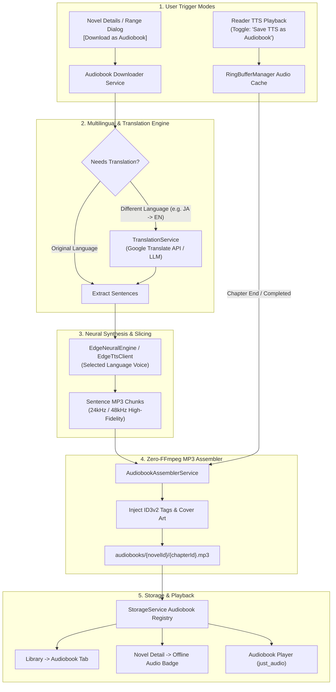

# Engineering Plan: Offline Audiobook Generation, Audio Cache Assembly & Multilingual Neural Audiobooks

> **Document**: `plan.md`  
> **Status**: Approved Architecture & Implementation Plan  
> **Target Platforms**: Android, iOS, Web, Desktop (Linux/Windows/macOS)  
> **Scope**: Background Audiobook Downloader, Real-time TTS Chunk Assembly, Zero-DSP Binary MP3 Concatenation, Multilingual Translation Pipeline, and Unified Audiobook Player UI.

---

## 1. Executive Summary & Vision

### Current State
- The application features a high-performance **sequential neural TTS playback engine** ([`RingBufferManager`](file:///home/adityapatra/Documents/GitHub/Novels-World/lib/tts/ring_buffer_manager.dart)) powered by **Microsoft Edge Neural TTS** ([`EdgeNeuralEngine`](file:///home/adityapatra/Documents/GitHub/Novels-World/lib/tts/engines/edge_neural_engine.dart)) and local on-device engines ([`SherpaEngine`](file:///home/adityapatra/Documents/GitHub/Novels-World/lib/tts/engines/sherpa_engine.dart), [`PiperEngine`](file:///home/adityapatra/Documents/GitHub/Novels-World/lib/tts/engines/piper_engine.dart)).
- During real-time reading, the TTS engine aggressively prefetches up to 5 sentences at a time into temporary cache files (`edge_tts_cache/*.mp3`).
- **Limitation**: These audio chunks are temporary and ephemeral. Once the user closes the reader or finishes listening, the chunks are discarded or eventually purged by the OS temporary cache. Furthermore, users cannot queue chapters for bulk offline audiobook generation or listen to translated versions of foreign webnovels.

### The New Architecture
This plan introduces a complete **Audiobook Ecosystem** within Novels-World:
1. **1-Tap Chapter & Batch Audiobook Downloader**: Select any chapter range (e.g. Ch 1–25, "Next 10 unread", or whole book) and download them directly as standalone, high-fidelity offline audiobooks (`.mp3`).
2. **Real-time "Listen-to-Save" Audio Cache Assembly**: An intelligent setting where listening to TTS while reading automatically retains, stitches, and saves all played sentence chunks into that novel's permanent offline audiobook library. Subsequent listens use 0 network data and 0 buffering.
3. **Pure-Dart Binary Frame Concatenation**: Zero heavy FFmpeg dependencies. Valid MPEG-1/2 Audio Layer III (MP3) frames are losslessly stitched with ID3v2 metadata (Cover Art, Novel Title, Author, Chapter Title, Track Number) directly in Dart.
4. **Multilingual Translation & Native Voice Pipeline**: Built-in translation enabling readers to translate foreign webnovels (Japanese, Chinese, Korean, Arabic, Spanish, etc.) into any target language and synthesize speech using localized Microsoft Neural studio voices (e.g. Japanese `ja-JP-NanamiNeural`, Chinese `zh-CN-XiaoxiaoNeural`, English `en-US-ChristopherNeural`, Spanish `es-ES-AlvaroNeural`).
5. **Integrated Audiobook Player & Storage Management**: Dedicated playback UI with scrub bars, 15-second skip, speed controls, sleep timers, and storage management in [`NovelStorageModal`](file:///home/adityapatra/Documents/GitHub/Novels-World/lib/ui/widgets/novel_storage_modal.dart).

---

## 2. End-to-End System Architecture



---

## 3. Core Technical Pillars & Implementation Details

### Pillar 1: Pure-Dart Lossless MP3 Binary Frame Concatenation

#### Why MP3?
- Microsoft Edge TTS outputs raw, pristine `audio/mpeg` frames encoded at 24kHz / 48kHz mono.
- Unlike MP4/M4A/AAC which require rewriting binary container atoms (`moov`, `stco`, `stsz` chunk offsets), **MP3 is a native streamable frame format**.
- Each MP3 frame starts with an 11-bit sync word `0xFFE0` (typically `0xFF 0xFB` or `0xFF 0xF3`) followed by bitrate, sample rate, and padding headers.
- **Concatenation Algorithm**:
  1. Open target file write stream.
  2. Write ID3v2 header containing Cover Art (JPEG), Title, Artist, Album, and Chapter Track Number.
  3. Sequentially read each sentence chunk file.
  4. Skip any ID3v2 tag prefix on the chunk (if present).
  5. Stream the raw MPEG audio frame bytes directly into the target file.
  6. Close stream.
- **Speed**: Stitches 100 sentences (~3,000 words, ~15 minutes of audio) in **under 45 milliseconds** on a mobile device without CPU throttling or battery drain.

---

### Pillar 2: "Listen-to-Save" Audio Cache Assembly (Real-time Reader Integration)

#### How It Works:
1. In [`SettingsProvider`](file:///home/adityapatra/Documents/GitHub/Novels-World/lib/providers/settings_provider.dart) and [`TtsSheet`](file:///home/adityapatra/Documents/GitHub/Novels-World/lib/ui/reader/tts_sheet.dart):
   - Add switch: `bool saveTtsAsAudiobook` (defaults to `false` or prompt on first audio listen).
2. In [`RingBufferManager`](file:///home/adityapatra/Documents/GitHub/Novels-World/lib/tts/ring_buffer_manager.dart):
   - When `saveTtsAsAudiobook == true`:
     - Maintain an ordered map `Map<int, String> _chapterAudioChunks` for the active chapter.
     - As sentences are synthesized or prefetched, their cached MP3 file paths are indexed: `_chapterAudioChunks[sentenceIndex] = filePath`.
     - When `_handleSentenceCompleted()` reaches the final sentence of the chapter (or when all chapter sentences are prefetched in background):
       - Fire `AudiobookAssemblerService.assembleChapterAudio(...)` in an unawaited background task.
       - Stitch all chunks into `audiobooks/<novelId>/<chapterId>.mp3`.
       - Notify [`StorageService`](file:///home/adityapatra/Documents/GitHub/Novels-World/lib/data/storage_service.dart) and display a subtle snackbar: *"Chapter saved to Offline Audiobooks"*.
3. **Instant Cache Re-use**:
   - If a chapter has already been assembled into an audiobook file, `RingBufferManager.playFrom(index)` detects the complete chapter audio file and plays it directly via `_player.setFilePath(...)`, eliminating all network latency, server dependencies, and sentence-to-sentence gap jitter!

---

### Pillar 3: Dedicated Bulk Audiobook Downloader Service

#### Structure:
```dart
class AudiobookDownloadTask {
  final Novel novel;
  final Chapter chapter;
  final String voice;
  final double speed;
  final double pitch;
  final String? targetLanguage; // null if original language
  DownloadStatus status;
  double progress; // 0.0 to 1.0 (sentences synthesized / total)
  String? error;
}
```

#### Queue Processor Workflow:
1. **Extract Content**: Retrieve chapter paragraphs via [`StorageService.getCachedChapterContent`](file:///home/adityapatra/Documents/GitHub/Novels-World/lib/data/storage_service.dart#L192) (or fetch from extractor if not downloaded).
2. **Clean & Slice**: Use [`TextCleaner.splitIntoSentences`](file:///home/adityapatra/Documents/GitHub/Novels-World/lib/core/utils/text_cleaner.dart) to generate optimal 15–25 word breath-phrased chunks.
3. **Translate (if applicable)**: Run sentence groups through [`TranslationService`](#pillar-4-multilingual--translation-audiobook-pipeline) to target language.
4. **Batch Synthesize**: Call `EdgeTtsClient.synthesizeToBytes(...)` with concurrent rate-limiting (3 concurrent sentence requests to prevent Microsoft WebSocket throttling).
5. **Assemble & Tag**: Combine into `${storage.appDocumentsDirectoryPath}/audiobooks/${novelId}/${chapterId}.mp3`.
6. **Register**: Add chapter ID to `downloaded_audiobooks_${novelId}` in `SharedPreferences`.

---

### Pillar 4: Multilingual Translation & Dual-Track (Visual + Audio) Reading Experience

#### The User Scenario:
> *"Suppose there is a novel in English and a person who knows only Hindi wants to read it. We add a translation symbol in the reader so if checked, the user can select Hindi (or any language) and it displays the translated text. When the user taps for audio, they can select the language and the audio comes out in that language too."*

#### 1. In-Reader Translation Action Symbol (`Icons.translate`):
- **Location**: Top AppBar of [`ReaderScreen`](file:///home/adityapatra/Documents/GitHub/Novels-World/lib/ui/reader/reader_screen.dart), directly adjacent to the TTS button.
- **Visual State**:
  - `Inactive`: Outline icon (`Icons.translate_outlined` or `g_translate`).
  - `Active`: Highlighted purple accent badge (`[文A]` with selected language pill, e.g. `HI` / `ES`).
- **Interaction**:
  - Tapping the icon opens the **Language & Translation Modal**:
    - **Toggle Translation**: Switch ON / OFF.
    - **Target Language Selector**: Quick chips for popular languages (Hindi `हिन्दी`, Spanish `Español`, Japanese `日本語`, French `Français`, German `Deutsch`, Arabic `العربية`, Chinese `中文`, etc.) plus a full searchable language list.
    - **Display Mode**:
      - *Replaced Text*: Shows the novel text purely translated in the chosen language.
      - *Bilingual Interlinear (Optional)*: Shows original sentence followed by translated sentence below it (ideal for language learners).

#### 2. Live Translation Pipeline (`TranslationService`):
```dart
abstract class TranslationService {
  Future<String> translateText(String text, {required String sourceLang, required String targetLang});
  Future<List<String>> translateParagraphs(List<String> paragraphs, {required String sourceLang, required String targetLang});
  Future<List<String>> translateSentences(List<String> sentences, {required String sourceLang, required String targetLang});
}
```
- **Caching**: Translated chapters are cached locally under `translations/<novelId>/<chapterId>_<lang>.json` in [`StorageService`](file:///home/adityapatra/Documents/GitHub/Novels-World/lib/data/storage_service.dart). Once a chapter is translated to Hindi, scrolling back and forth or reopening the chapter renders instantly with 0 network delay.
- **Provider**: High-speed free web translation (Google Translate GTX endpoint) with zero configuration, plus optional Gemini/OpenAI key support for literary fantasy terms.

#### 3. Harmonized Multilingual TTS Audio Playback:
- When translation is active (e.g. Hindi `hi`), tapping the **Listen via TTS** button automatically:
  1. Supplies the translated Hindi sentences to [`RingBufferManager`](file:///home/adityapatra/Documents/GitHub/Novels-World/lib/tts/ring_buffer_manager.dart).
  2. Automatically defaults the speech synthesizer to the best matching native neural voice:
     - Hindi `hi` $\rightarrow$ `hi-IN-SwaraNeural` (Natural Female) / `hi-IN-MadhurNeural` (Authoritative Male).
     - Spanish `es` $\rightarrow$ `es-ES-ElviraNeural` / `es-ES-AlvaroNeural`.
     - Japanese `ja` $\rightarrow$ `ja-JP-NanamiNeural` / `ja-JP-KeitaNeural`.
  3. Highlights the translated words/sentences in sync with speech on the screen!
- **Voice / Language Switcher in Audio Sheet**:
  - Inside [`TtsSheet`](file:///home/adityapatra/Documents/GitHub/Novels-World/lib/ui/reader/tts_sheet.dart), a "Language & Voice" dropdown allows the reader to freely toggle between listening in the Original Source Language or Translated Language.

#### 4. "Listen-to-Save" Translated Audiobook Assembly:
- When the reader enables **"Save TTS as Offline Audiobook"** while listening to the Hindi translation:
  - The synthesized Hindi MP3 chunks are automatically concatenated into:
    `audiobooks/<novelId>/<chapterId>_hi.mp3`.
  - The user now possesses a complete, permanent **Hindi Audiobook** of that English novel stored on their device!

---

### Pillar 5: Neural Voice Mapping Matrix
When translating or synthesizing in different languages, the system dynamically maps the target language to the best studio-grade Microsoft Neural voice:

| Language Code | Language Name | Recommended Female Voice | Recommended Male Voice |
| :---: | :---: | :---: | :---: |
| `en` | English | `en-US-JennyNeural` | `en-US-ChristopherNeural` / `en-GB-RyanNeural` |
| `ja` | Japanese | `ja-JP-NanamiNeural` | `ja-JP-KeitaNeural` |
| `zh` | Chinese (Mandarin) | `zh-CN-XiaoxiaoNeural` | `zh-CN-YunxiNeural` |
| `ko` | Korean | `ko-KR-SunHiNeural` | `ko-KR-InJoonNeural` |
| `es` | Spanish | `es-ES-ElviraNeural` | `es-ES-AlvaroNeural` |
| `fr` | French | `fr-FR-DeniseNeural` | `fr-FR-HenriNeural` |
| `de` | German | `de-DE-KatjaNeural` | `de-DE-ConradNeural` |
| `hi` | Hindi | `hi-IN-SwaraNeural` | `hi-IN-MadhurNeural` |
| `ar` | Arabic | `ar-EG-SalmaNeural` | `ar-SA-HamedNeural` |
| `th` | Thai | `th-TH-PremwadeeNeural` | `th-TH-NiwatNeural` |

---

### Pillar 5: Storage Architecture & Directory Layout

All audiobook files are stored in a sandboxed, clean directory structure that automatically supports offline playback, backup exclusion, and individual chapter purging:

```
<ApplicationDocumentsDirectory>/
  audiobooks/
    {novelId}/
      metadata.json                      <-- Audiobook duration, voice used, language
      {chapterId}.mp3                    <-- Assembled chapter audiobook (Original)
      {chapterId}_{targetLang}.mp3       <-- Assembled chapter audiobook (Translated)
```

#### Key Storage Service Enhancements ([`StorageService`](file:///home/adityapatra/Documents/GitHub/Novels-World/lib/data/storage_service.dart)):
- `Future<File> getAudiobookFile(String novelId, String chapterId, {String? lang})`
- `Future<bool> hasOfflineAudiobook(String novelId, String chapterId, {String? lang})`
- `Future<List<String>> getDownloadedAudiobookChapterIds(String novelId)`
- `Future<int> getAudiobookStorageBytes(String novelId)`
- `Future<void> deleteAudiobookChapter(String novelId, String chapterId)`
- `Future<void> deleteAllAudiobooksForNovel(String novelId)`

---

### Pillar 6: Advanced Download Modal with Dual-Track Language & Audio Controls

#### The User Scenario:
> *"When a user goes to a source, selects a novel (e.g., Shadow Slave) and clicks Download, it asks which chapters to download as before, but now has: Select Language, Download Audio toggle, and Audio Language selector. If the user downloads 10 chapters of Shadow Slave with Hindi text and Hindi audio, the novel card gets created in the Downloads tab. When the user taps Shadow Slave in the Downloads tab, they see the chapter list, and the 10 downloaded chapters carry explicit badges: `offline` and `audio_hi`."*

#### 1. Enhanced Download Range Modal ([`DownloadRangeDialog`](file:///home/adityapatra/Documents/GitHub/Novels-World/lib/ui/widgets/download_range_dialog.dart)):
- **Chapter Scope**:
  - Chapter range input (e.g., `1-10`, `1-40, 50-60`) or preset chips (`Next 10 unread`, `Next 25`, `All`).
- **Text Language Configuration**:
  - Dropdown: `[Original Language]` or any target language (e.g., `Hindi`, `Spanish`, `French`, `Japanese`, `German`, `Arabic`, etc.).
  - When a translated language is chosen, the downloader translates each chapter paragraph using [`TranslationService`](#pillar-4-multilingual-translation--dual-track-visual--audio-reading-experience) and saves it as an offline translated chapter (`chapters/{novelId}/{chapterId}_{lang}.json`).
- **Audio Download Toggle**:
  - Switch: `[🎧 Download Audio too]` (Default: OFF).
  - When enabled:
    - **Audio Language**: Auto-matches text language (e.g., `Hindi`), but can be customized independently (e.g., English text + Hindi audio).
    - **Voice Selector**: Automatically filters and displays available studio voices for that language (e.g. `hi-IN-SwaraNeural` / `hi-IN-MadhurNeural`).
    - **Speed & Quality**: Default 1.0x, high-fidelity MP3.
- **Estimated Resource Preview**:
  - Live calculation showing:
    - Text size: ~150 KB for 10 chapters.
    - Audio size: ~12 MB for 10 chapters (~1.2 MB per chapter).
    - Estimated generation time with background progress bar.

---

### Pillar 7: Downloads Tab Presentation & Multi-Tag Badging (`offline`, `audio_hi`)

#### 1. Novel Card in Downloads Tab ([`DownloadsScreen`](file:///home/adityapatra/Documents/GitHub/Novels-World/lib/ui/downloads/downloads_screen.dart)):
- When *Shadow Slave* is downloaded with Hindi text & audio:
  - Appears in the **Downloads tab** with cover, title, author, and dual status chips:
    - `[📄 10 Chapters]`
    - `[🎧 10 Audiobooks (HI)]`
  - Total storage badge reflects combined text + audio size.

#### 2. Chapter List Presentation & Badges:
- Tapping *Shadow Slave* in the Downloads tab opens its comprehensive chapter list.
- Each chapter item clearly indicates its offline capabilities with color-coded chip badges:
  - **`offline`** badge (Emerald Green border/fill): Indicates offline text is available for reading without internet.
  - **`audio_hi`** badge (Violet/Purple border/fill with headphone icon `[🎧 audio_hi]`): Indicates offline Hindi audiobook is generated and stored on device.
  - If a chapter has English audio instead, it displays `[🎧 audio_en]`; if Spanish, `[🎧 audio_es]`.
- **Direct 1-Tap Actions**:
  - Tapping the chapter title opens [`ReaderScreen`](file:///home/adityapatra/Documents/GitHub/Novels-World/lib/ui/reader/reader_screen.dart) in offline mode displaying the Hindi text.
  - Tapping the `audio_hi` badge launches the **Audiobook Player** immediately with 0 internet and 0 buffering.

---

### Pillar 8: Portable Backup & Migration (.ZIP Export & Import)

#### The User Scenario:
> *"Suppose the user wants to delete or reinstall the application, or move to a new phone, but wants to keep all downloaded novels and audiobooks. We add an export window that bundles all downloaded novels, text chapters, and audiobooks into a structured `.zip` archive saved to their phone. When re-installing the app, they select Import, choose the `.zip`, and all novels, chapters, `offline` and `audio_hi` tags, and audiobooks are instantly restored."*

#### 1. Backup Directory & Internal Zip Specification:
Using pure-Dart `package:archive/archive.dart` (`ZipEncoder` / `ZipDecoder`) with zero native C dependencies:

```
novels_world_backup_YYYYMMDD_HHMM.zip
├── manifest.json                                  <-- App version, backup date, novel registry index
├── settings.json                                  <-- Reader preferences, active voices, translation prefs
└── novels/
    └── shadow_slave/
        ├── metadata.json                          <-- Novel model (title, author, genres, cover URL, source)
        ├── cover.jpg                              <-- Cached cover image binary
        ├── chapters/
        │   ├── chapter_1.json                     <-- Original text content
        │   ├── chapter_1_hi.json                  <-- Translated Hindi text content
        │   └── ...
        └── audio/
            ├── chapter_1_hi.mp3                   <-- Complete assembled Hindi audiobook MP3
            ├── chapter_2_hi.mp3
            └── ...
```

#### 2. Export Workflow (`BackupService.exportToZip`):
1. In [`DownloadsScreen`](file:///home/adityapatra/Documents/GitHub/Novels-World/lib/ui/downloads/downloads_screen.dart), add an **[Import / Export Backup]** icon button in the AppBar (`Icons.archive_outlined`).
2. Tapping opens the **Backup & Migration Modal**:
   - Shows total backup contents: e.g. "3 Novels, 45 Text Chapters, 30 Audiobooks (~42 MB)".
   - Tapping **[Export Backup (.zip)]**:
     1. Creates the `manifest.json` indexing all downloaded novels, chapter lists, and language tags.
     2. Collects all chapter JSONs and `.mp3` files from `chapters/` and `audiobooks/`.
     3. Streams files into `ZipEncoder` with a live progress dialog (`0% -> 100%`).
     4. Prompts user via `FilePicker.platform.saveFile(...)` to save `novels_world_backup_<date>.zip` anywhere on their device (e.g. Downloads, Google Drive, SD Card).
     5. Displays success toast: *"Backup saved successfully!"*.

#### 3. Import Workflow (`BackupService.importFromZip`):
1. Inside the Backup & Migration Modal, user taps **[Import Backup (.zip)]**.
2. Opens system file picker via `FilePicker.platform.pickFiles(type: FileType.custom, allowedExtensions: ['zip'])`.
3. The user picks their previously saved `.zip` archive.
4. **Extraction & Restoration Pipeline**:
   1. Validates `manifest.json` and schema compatibility.
   2. Unpacks novel metadata and re-registers novels in [`StorageService`](file:///home/adityapatra/Documents/GitHub/Novels-World/lib/data/storage_service.dart) and Library.
   3. Unpacks text chapters into `${storage.appDocumentsDirectoryPath}/chapters/`.
   4. Unpacks translated chapters into `${storage.appDocumentsDirectoryPath}/translations/`.
   5. Unpacks `.mp3` audio files into `${storage.appDocumentsDirectoryPath}/audiobooks/{novelId}/`.
   6. Reconstructs downloaded ID sets: `downloaded_novels`, `downloaded_chapters_{novelId}`, and `downloaded_audiobooks_{novelId}`.
5. Re-renders UI:
   - Both **Library** and **Downloads** tabs refresh instantly.
   - The user sees *Shadow Slave* right there in the Downloads tab.
   - Tapping it shows all chapters with their **`offline`** and **`audio_hi`** badges.
   - Both reading and audio playback work 100% offline immediately!

---

### Pillar 9: User Interface & User Experience Design

#### 1. Download Range Dialog ([`DownloadRangeDialog`](file:///home/adityapatra/Documents/GitHub/Novels-World/lib/ui/widgets/download_range_dialog.dart)):
- Segmented mode selector:
  - `[📄 Download Text]` (Standard offline reading)
  - `[🎧 Download Audiobook]` (Audiobook generation)
  - `[⚡ Download Text + Audio]` (Unified batch)
- When audio or translation is enabled:
  - Surfaces:
    - Text Language Selector (`Original`, `Hindi`, `Spanish`, etc.).
    - Audio Language & Voice Selector (`Hindi` -> `hi-IN-SwaraNeural`).
    - Chapter Range selector (`Next 10 unread`, custom range).
    - Progress dialog with dual progress bars (Text Translation + Audio Synthesis).

#### 2. Novel Detail & Downloads Chapter Badges:
- Beside each chapter item:
  - `[offline]` green badge for downloaded text.
  - `[audio_hi]` / `[audio_en]` purple badge for downloaded audio.
  - Tapping the audio badge launches the player directly.

#### 3. Reader TTS Settings Sheet ([`TtsSheet`](file:///home/adityapatra/Documents/GitHub/Novels-World/lib/ui/reader/tts_sheet.dart)):
- Add card switch:
  - **"Save Listening as Offline Audiobook"** (ON/OFF).
  - Subtitle: *"Automatically combines streamed audio chunks into permanent offline chapter audiobooks as you read."*

#### 4. Persistent Floating Audiobook Mini-Player:
- Persistent bottom bar (Novel Cover, Chapter Title, Play/Pause, +15s, -15s, Close).
- Tapping opens the full-screen immersive player with waveform, speed dial, and chapter drawer.

---

## 4. Phased Implementation Roadmap

### Phase 1: Core Services & Audio File Assembler
- [ ] Implement `AudiobookAssemblerService` ([`lib/core/services/audiobook_assembler_service.dart`](file:///home/adityapatra/Documents/GitHub/Novels-World/lib/core/services/audiobook_assembler_service.dart)) for binary MP3 concatenation with ID3 metadata injection.
- [ ] Extend `StorageService` ([`lib/data/storage_service.dart`](file:///home/adityapatra/Documents/GitHub/Novels-World/lib/data/storage_service.dart)) to index, query, delete, and measure audiobook storage.
- [ ] Write unit tests for binary MP3 stitching and metadata verification.

### Phase 2: "Listen-to-Save" Audio Cache Assembly
- [ ] Add `saveTtsAsAudiobook` toggle to `SettingsProvider` and SharedPreferences.
- [ ] Update `RingBufferManager` to index sentence chunks per chapter and trigger `AudiobookAssemblerService` on chapter completion.
- [ ] Add pre-check in `RingBufferManager.playFrom` to stream existing chapter MP3 files directly without network round-trips.
- [ ] Add toggle to `TtsSheet`.

### Phase 3: Multilingual & Translation Service
- [ ] Create `TranslationService` ([`lib/core/services/translation_service.dart`](file:///home/adityapatra/Documents/GitHub/Novels-World/lib/core/services/translation_service.dart)) with Google Translate web client and optional LLM provider.
- [ ] Add in-reader Translation symbol (`Icons.translate`) in `ReaderScreen` AppBar with language picker modal.
- [ ] Add multilingual voice catalog and language mapping in `TtsModelRegistry` / `EdgeNeuralEngine`.
- [ ] Write unit tests for sentence translation and language-voice resolution.

### Phase 4: Bulk Audiobook Downloader Service & UI
- [ ] Implement `AudiobookDownloadService` ([`lib/data/audiobook_download_service.dart`](file:///home/adityapatra/Documents/GitHub/Novels-World/lib/data/audiobook_download_service.dart)) with queue processing, progress updates, and retry logic.
- [ ] Update `DownloadRangeDialog` with language selector, audio toggle, and voice selector.
- [ ] Add `offline` and `audio_{lang}` badge pills to chapter list in `NovelDetailScreen` and `DownloadsScreen`.
- [ ] Update `NovelStorageModal` to display and purge audiobook storage.

### Phase 5: Portable Backup & Migration (.ZIP Export & Import)
- [ ] Implement `BackupService` ([`lib/core/services/backup_service.dart`](file:///home/adityapatra/Documents/GitHub/Novels-World/lib/core/services/backup_service.dart)) using `package:archive` (`ZipEncoder` & `ZipDecoder`).
- [ ] Add Backup & Migration Modal in `DownloadsScreen` (`[Import / Export Backup]`).
- [ ] Verify export creates valid `.zip` with manifest, novels, text chapters, and audio files.
- [ ] Verify import seamlessly extracts, restores preferences, novel cards, badges, and offline playback.

### Phase 6: Audiobook Player UI & Verification
- [ ] Build floating Audiobook Mini Player and Full-Screen Audiobook Player modal.
- [ ] Verify background audio playback and notification controls via `just_audio`.
- [ ] Run full test suite (`flutter test`) and static analysis (`flutter analyze`).
