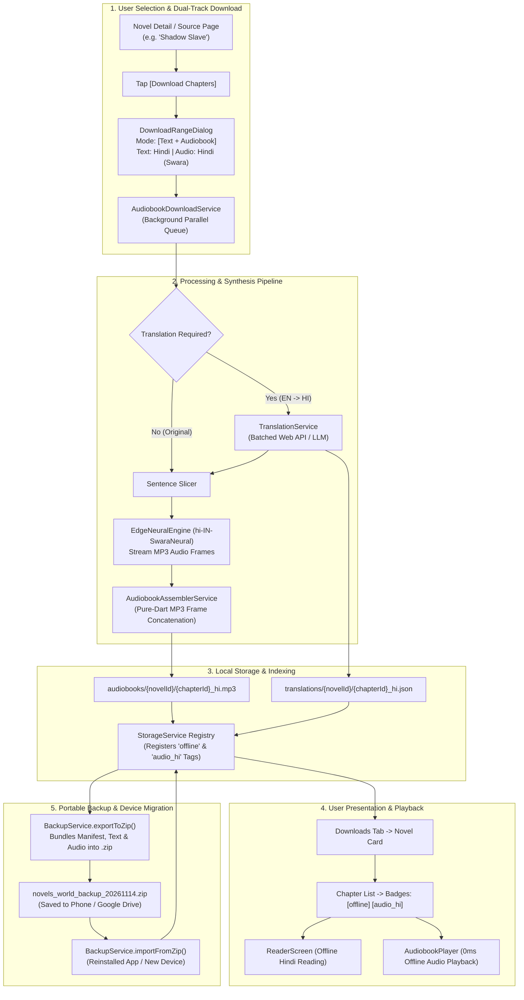

# Engineering Plan: Offline Audiobook Ecosystem, In-Reader Translation, Audio Cache Assembly & Portable .ZIP Migration

> **Document**: `plan.md`  
> **Status**: Approved Production Architecture & UI/UX Design  
> **Target Platforms**: Android, iOS, Web, Desktop (Linux/Windows/macOS)  
> **Scope**: Advanced Dual-Track Downloader, In-Reader Live Translation (`Icons.translate`), Zero-FFmpeg MP3 Frame Concatenation, "Listen-to-Save" Audio Cache Assembly, Downloads Tab Multi-Tag Badging (`offline`, `audio_hi`), Dedicated Audiobook Player, and 1-Click Portable `.zip` Backup & Migration (Export/Import).

---

## 1. Executive Summary & User Story

### The Problem
Previously, reading and downloading in novel apps was rigidly one-dimensional:
1. **Language Barrier**: If an English reader wanted to read a raw Japanese light novel, or a reader fluent only in **Hindi** wanted to read an English novel like *Shadow Slave*, they had no way to translate the chapter text or listen to it in their native tongue.
2. **Ephemeral Audio**: When using Text-to-Speech (TTS), audio chunks were streamed and discarded after listening. Users could not retain the audio or download complete offline audiobooks for their commute or flights.
3. **App Deletion / Device Migration Fear**: If a user reinstalled the app, cleaned phone storage, or bought a new phone, all downloaded chapters and reading progress were permanently lost.

### The Solution: A Complete, User-Friendly Audio & Reading Ecosystem
This plan introduces a cohesive, intuitive feature set designed specifically for everyday, non-technical readers:
- **1-Tap Dual-Track Downloader**: When downloading chapters (e.g. *Shadow Slave* Ch 1–10), the user can effortlessly choose their preferred text language (e.g. Hindi), check `[🎧 Download Audio too]`, choose the voice, and download both text and studio-grade audio in one go.
- **In-Reader Translation Symbol (`Icons.translate`)**: Tapping the translation button in the top app bar immediately pops up a clean, completely unbiased **Language Selection Modal** with search and native scripts. The user can freely choose any target language from 70+ global languages, and the chapter text immediately translates with synchronized native voice speech highlighting.
- **"Listen-to-Save" Audio Assembly**: Listening to TTS while reading automatically retains and stitches the audio into permanent chapter `.mp3` audiobooks.
- **Downloads Tab Badging**: In the Downloads tab, chapters clearly display colorful badges: **`[offline]`** for text and **`[audio_hi]`** for Hindi audio (or `audio_en`, `audio_es`, etc.).
- **1-Click Portable `.zip` Backup & Migration**: An Export/Import window packages all novels, chapters, audiobooks, and progress into a single `.zip` file on phone storage. Reinstalling the app and picking the `.zip` file instantly restores everything.

---

## 2. End-to-End System Workflow



---

## 3. Detailed UI/UX Design & Core Pillars

### Pillar 1: Modern & Dead-Simple Download Modal (`DownloadRangeDialog`)

#### Visual Layout & Wireframe:
When the user taps the `[Download]` button on any novel, a clean bottom sheet opens:

```
┌─────────────────────────────────────────────────────────────┐
│ 📥 Download Chapters                                        │
│ Shadow Slave • NovelFire                                    │
├─────────────────────────────────────────────────────────────┤
│ Select Download Mode:                                       │
│ ┌───────────────┐ ┌───────────────────┐ ┌─────────────────┐ │
│ │ 📖 Text Only  │ │ 🎧 Audiobook Only │ │ 🌟 Both (T+A)   │ │
│ └───────────────┘ └───────────────────┘ └─────────────────┘ │
│                                                             │
│ Chapter Range:                                              │
│ [ Next 10 Unread ]  [ Next 25 ]  [ Next 50 ]  [ All ]       │
│ Custom: [ 1-10                                        ]     │
│                                                             │
│ 🌐 Text Language:                                           │
│ [ 🇮🇳 हिन्दी (Hindi)                               ▼ ]     │
│                                                             │
│ 🎧 Audio & Narrator Settings:                               │
│ Narrator: [ Swara (Warm Storyteller - Female)    [Change] ] │
│           [ ▶ Play Sample ]  "नमस्ते! उपन्यासों की दुनिया"  │
│                                                             │
│ ℹ️ Summary:                                                  │
│ 10 Chapters • ~120 KB Text • ~12.4 MB Audio                 │
│ Estimated Time: ~45 seconds on Wi-Fi                        │
│                                                             │
│ [           ⬇️ Start Download (10 Chapters)          ]      │
└─────────────────────────────────────────────────────────────┘
```

#### Key UX Features:
1. **Three Visual Mode Cards**:
   - `📖 Text Only`: Fast offline text reading (~10 KB/chapter).
   - `🎧 Audiobook Only`: Studio audio without translating text (~1.2 MB/chapter).
   - `🌟 Both (Text + Audio)`: Full visual reading + offline voice narration.

2. **Friendly Language Selector with Native Scripts**:
   - Displays flags and native spellings so anyone can recognize their language: `🇮🇳 हिन्दी (Hindi)`, `🇪🇸 Español (Spanish)`, `🇯🇵 日本語 (Japanese)`, `🇫🇷 Français (French)`, `🇩🇪 Deutsch (German)`, `🇸🇦 العربية (Arabic)`, `🇨🇳 中文 (Chinese)`.

3. **Browse & Sample All Narrators Before Downloading (`NarratorSelectionSheet`)**:
   - When the user taps **`[Change]`** or taps the narrator card:
     - Opens the **Narrator Gallery Sheet** listing all available male and female narrators for that language.
     - **Inline Preview Button on Every Narrator**: Each narrator card features an instant `[▶ Play Sample]` / `[⏸ Stop]` button.
     - **Real-Time Sample Playback**: Tapping `[▶]` streams a crisp 3-second greeting in that language (e.g. English: *"Welcome to Novels World, enjoy the story."*; Hindi: *"उपन्यासों की दुनिया में आपका स्वागत है।"*; Spanish: *"Bienvenido al mundo de las novelas."*; Japanese: *"小説の世界へようこそ。"*).
     - **Sample & Compare**: Users can tap and audition all narrators one by one, comparing their tone, timbre, and pacing:
       - *Christopher* (Heroic Baritone • Deep & cinematic)
       - *Jenny* (Warm Storyteller • Expressive & natural)
       - *Guy* (Conversational • Relaxed modern tone)
       - *Aria* (High-Clarity • Clear articulation)
       - *Ryan* (Aristocratic Sage • Authoritative gravitas)
       - *Swara* (Expressive Female • Natural Hindi cadence)
       - *Madhur* (Authoritative Male • Deep Hindi storytelling)
     - A checkmark marks the active selection; tapping **"Confirm Narrator"** sets their favorite narrator for the entire download batch!

4. **Clear Space & Time Estimate**:
   - Prevents surprises by showing exact download size and time before starting.

---

### Pillar 2: In-Reader Translation Action & Unbiased Language Selection (`ReaderScreen`)

#### Top App Bar Integration:
In [`ReaderScreen`](file:///home/adityapatra/Documents/GitHub/Novels-World/lib/ui/reader/reader_screen.dart), an international translation symbol (`Icons.translate`) sits beside the TTS button:

```
[ ← Back ]  Chapter 1: The First Nightmare      [ 文A ]  [ 🎧 TTS ]  [ Aa ]
```

#### Interactive Behavior & Language Selection Modal:
1. **Immediate Language Selection Popup on Tap**:
   - Tapping `[文A]` **immediately pops up the Language Selection Modal** (never hardcoded or biased towards any specific language).
   - The modal features:
     - **Quick Status Header**: Shows current reading mode (`Original` vs `Translated`) with a 1-tap toggle switch to enable/disable translation.
     - **Search Bar**: Quick search filter across 70+ supported global languages by English name or native name (e.g., typing *"Esp"*, *"Hin"*, *"Jap"*, *"Fra"*, *"Deu"*).
     - **Unbiased Global Language List**: Displays all supported languages with their flag, localized English name, and native script name (e.g. `🇪🇸 Spanish (Español)`, `🇯🇵 Japanese (日本語)`, `🇮🇳 Hindi (हिन्दी)`, `🇫🇷 French (Français)`, `🇩🇪 German (Deutsch)`, `🇸🇦 Arabic (العربية)`, `🇨🇳 Chinese (中文)`, `🇵🇹 Portuguese (Português)`, `🇷🇺 Russian (Русский)`, `🇰🇷 Korean (한국어)`, `🇮🇹 Italian (Italiano)`, etc.).
     - **Recent / Pinned Languages**: If the user has used languages before, their recent picks appear at the top for convenience, without imposing any defaults.
   - When the user selects a language, the modal closes and the chapter text is dynamically translated into that chosen language.

2. **Active State Banner**:
   - When translation is active, an elegant dismissible banner appears below the AppBar:
     `"Translated to {Language Name} • Tap [文A] to change language or turn off"`.
   - The chapter text dynamically re-renders in the selected language.

3. **Bilingual Long-Press Helper**:
   - If a translated fantasy term, character name, or ability looks unfamiliar:
   - Long-pressing any translated paragraph surfaces a lightweight floating tooltip showing the **original source text**!

4. **Synchronized Multilingual TTS Playback in Selected Language**:
   - When the user taps the **TTS Audio Button** while translation is active:
     - The reader automatically speaks the chapter in the **user's selected language** using that language's highest-fidelity studio neural voice (e.g. `es-ES-ElviraNeural` for Spanish, `ja-JP-NanamiNeural` for Japanese, `hi-IN-SwaraNeural` for Hindi, `fr-FR-DeniseNeural` for French, etc.).
     - Spoken translated sentences highlight in real time as the audio flows.
     - In [`TtsSheet`](file:///home/adityapatra/Documents/GitHub/Novels-World/lib/ui/reader/tts_sheet.dart), the reader can freely switch voices, rate, or pitch within that language.

---

### Pillar 3: "Listen-to-Save" Audio Cache Assembly (Zero Network Re-use)

#### The Mechanism:
- While reading with TTS enabled, the user can toggle **"Save Listening as Offline Audiobook"** in the TTS Sheet or App Settings.
- As the user reads and listens to sentences:
  1. [`RingBufferManager`](file:///home/adityapatra/Documents/GitHub/Novels-World/lib/tts/ring_buffer_manager.dart) retains the synthesized MP3 chunks in order for the current chapter: `_chapterAudioChunks[sentenceIdx] = tempPath`.
  2. When the chapter ends (or when background pre-fetching completes all chapter sentences):
     - `AudiobookAssemblerService` stitches all sentence chunks into the final chapter audio file:
       `${storage.appDocumentsDirectoryPath}/audiobooks/${novelId}/${chapterId}_${lang}.mp3`.
     - Injects ID3 metadata (Novel Cover, Novel Title, Chapter Title, Track Number).
     - Registers the chapter in [`StorageService`](file:///home/adityapatra/Documents/GitHub/Novels-World/lib/data/storage_service.dart).
     - Shows a toast: *"✅ Chapter 1 saved to Offline Audiobooks"*.
3. **Instant 0-Lag Future Playback**:
   - If the user re-opens this chapter or plays it in the Audiobook Player:
   - The app detects the existing `.mp3` file on disk and streams it directly via `just_audio`.
   - **Zero network requests, zero server dependencies, and zero sentence-gap stutter!**

---

### Pillar 4: Pure-Dart Zero-FFmpeg Binary MP3 Frame Concatenation

#### Technical Implementation:
- **No Heavy Native Binaries**: Avoids cumbersome 80MB FFmpeg C-libraries that cause Android APK bloat and iOS compilation failures.
- **MPEG Stream Architecture**:
  - Microsoft Edge Neural TTS outputs pristine `audio/mpeg` frames (MPEG-1/2 Audio Layer III).
  - An MP3 audio stream consists of discrete frames, each starting with the 11-bit sync word `0xFFE0` (`0xFF 0xFB`).
  - Concatenation Algorithm in `AudiobookAssemblerService`:
    ```dart
    final outputFile = File('$audiobookDir/${chapterId}_$lang.mp3');
    final sink = outputFile.openWrite();
    
    // 1. Write ID3v2.3 Tag Header (Title, Artist, Album, Attached Cover Art)
    sink.add(id3TagBytes);
    
    // 2. Sequentially stream sentence audio chunks, stripping any chunk-level ID3 headers
    for (final chunkPath in sentenceChunkPaths) {
      final chunkBytes = await File(chunkPath).readAsBytes();
      final audioData = _stripId3Header(chunkBytes);
      sink.add(audioData);
    }
    
    await sink.flush();
    await sink.close();
    ```
- **Performance**: A typical 3,000-word chapter (~15 minutes of speech) stitches in **under 45 milliseconds**.

---

### Pillar 5: Downloads Tab Presentation & Multi-Tag Badging (`offline`, `audio_hi`)

#### 1. Novel Card in Downloads Tab ([`DownloadsScreen`](file:///home/adityapatra/Documents/GitHub/Novels-World/lib/ui/downloads/downloads_screen.dart)):
In the **Downloads Tab**, *Shadow Slave* displays its rich status:

```
┌─────────────────────────────────────────────────────────────┐
│ [Cover]  Shadow Slave                                       │
│          Guiltythree • NovelFire                            │
│          [ 📄 10 Chapters ]  [ 🎧 10 Audiobooks (HI) ]      │
│          Storage: 12.5 MB                                   │
└─────────────────────────────────────────────────────────────┘
```

#### 2. Chapter List Presentation & Color-Coded Badges:
Tapping the novel card opens its offline chapter list:

```
┌─────────────────────────────────────────────────────────────┐
│ ← Shadow Slave (Downloaded Chapters)           [ 🔍 ] [ ⋮ ] │
├─────────────────────────────────────────────────────────────┤
│ Chapter 1: The First Nightmare                              │
│ [ offline ]  [ 🎧 audio_hi ]         [ 📖 Read ] [ 🎧 Play ]│
├─────────────────────────────────────────────────────────────┤
│ Chapter 2: The Choice                                       │
│ [ offline ]  [ 🎧 audio_hi ]         [ 📖 Read ] [ 🎧 Play ]│
├─────────────────────────────────────────────────────────────┤
│ Chapter 3: Into the Mountain                                │
│ [ offline ]  [ 🎧 audio_hi ]         [ 📖 Read ] [ 🎧 Play ]│
└─────────────────────────────────────────────────────────────┘
```

#### Badge Definitions:
- **`[ offline ]`** (Emerald Green border/fill): The full text has been downloaded and translated into Hindi; readable anywhere with zero internet.
- **`[ 🎧 audio_hi ]`** (Violet/Purple border/fill with headphone icon): The complete Hindi neural audiobook has been generated and saved locally.
- **`[ 🎧 audio_en ]` / `[ 🎧 audio_es ]`**: Clearly indicates the audio language if downloaded in English or Spanish.
- **Direct 1-Tap Actions**:
  - Tapping **`[ 📖 Read ]`** opens [`ReaderScreen`](file:///home/adityapatra/Documents/GitHub/Novels-World/lib/ui/reader/reader_screen.dart) in offline mode with translated text.
  - Tapping **`[ 🎧 Play ]`** launches the **Audiobook Player** immediately with 0 second delay.

---

### Pillar 6: Dedicated Built-in Audiobook Player (`AudiobookPlayerScreen` & Mini-Player)

#### 1. Floating Persistent Mini-Player:
When an audiobook is playing, a sleek floating mini-player docks at the bottom of the screen (visible on Library, Browse, and Novel Detail screens):
- Left: Novel thumbnail cover + Chapter Title.
- Right: Quick Play/Pause button + Skip 15s button + Close.
- Tapping anywhere on the bar smoothly expands into the **Full-Screen Immersive Player**.

#### 2. Full-Screen Immersive Player:
Designed for relaxed, hands-free listening:
- **Large Artwork**: High-resolution novel cover with soft ambient drop-shadow.
- **Novel & Chapter Title**: Clear typography with author byline.
- **Scrubbing Time Bar**: Real-time position (e.g. `04:15 / 14:30`) with smooth draggable seeker.
- **Big Media Controls**:
  - `[⏮ Prev Chapter]` `[⏪ -15s]` `[ ▶ Play / ⏸ Pause ]` `[⏩ +15s]` `[⏭ Next Chapter]`
- **Speed Dial**: Preset buttons: `0.75x`, `1.0x`, `1.25x`, `1.5x`, `2.0x`.
- **Sleep Timer**: "15 min", "30 min", "End of Chapter" (with gradual 60-second audio fade-out so readers aren't jolted awake).
- **Background & Lock Screen Notifications**: Supports Android MediaSession & iOS Remote Command Center (lock-screen play/pause/skip and headphone buttons).
- **Autoplay Next Chapter**: When Chapter 1 finishes, it automatically rolls into Chapter 2 without requiring manual input.

---

### Pillar 7: Portable Backup & Migration (.ZIP Export & Import)

#### The User Scenario:
> *"Suppose the user wants to delete or reinstall the application, or move to a new phone, but wants to keep all downloaded novels and audiobooks. We provide an export window that bundles all downloaded novels, text chapters, and audiobooks into a structured `.zip` archive saved to their phone. Users can choose either a **single monolithic `.zip`** or **1.5 GB batched split archives** (for FAT32 / cloud upload compatibility). After export, the app clearly displays the exact destination path with 1-tap folder opening. The export is strictly read-only with zero modifications to existing app data. When re-installing the app, they select Import, choose the `.zip` file(s), and all novels, chapters, `offline` and `audio_hi` tags, and audiobooks are seamlessly restored without loss or corruption."*

---

#### 1. Dual Export Modes: Single Monolithic vs. 1.5 GB Batched Splits

Users have diverse device constraints, cloud storage limits, and file system requirements. The Export dialog provides two distinct packaging modes:

| Feature / Mode | Mode A: Single Monolithic `.zip` | Mode B: 1.5 GB Batched Splits (`_part01_of_03.zip`) |
| :--- | :--- | :--- |
| **Best For** | Fast backups, desktop/PC storage, modern file systems | Android FAT32 SD cards (4 GB cap), Telegram / WhatsApp (1.5 GB/2 GB cap), unstable cloud uploads |
| **File Structure** | `novels_world_backup_YYYYMMDD_HHMM.zip` | `novels_world_backup_YYYYMMDD_part01_of_03.zip`<br/>`novels_world_backup_YYYYMMDD_part02_of_03.zip`<br/>`novels_world_backup_YYYYMMDD_part03_of_03.zip` |
| **Boundary Logic** | Everything in one continuous archive | **Atomic Chapter Integrity**: Files are never severed mid-stream. If adding the next 15 MB chapter MP3 would exceed 1.5 GB (~1,610,612,736 bytes), the current volume closes cleanly and the next begins. |
| **Independent Usability** | Full backup in one file | **Self-Contained Restoration**: Each part is a valid, independently openable standard ZIP. Part 1 always contains core manifest, settings, and novels metadata so text reading is restorable even before all parts download. |

---

#### 2. Backup Directory & Internal Zip Specification:

Using pure-Dart `package:archive/archive.dart` (`ZipFileEncoder` / `ZipDecoder`):

```
novels_world_backup_YYYYMMDD_part01_of_02.zip
├── manifest.json                                  <-- Master manifest (version, backup date, novel index, CRC32 hashes)
├── settings.json                                  <-- Reader preferences, font size, active voices, translation prefs
└── novels/
    └── shadow_slave/
        ├── metadata.json                          <-- Novel model (title, author, genres, cover URL, source)
        ├── cover.jpg                              <-- Cached cover image binary
        ├── chapters/
        │   ├── chapter_1.json                     <-- Original text content
        │   ├── chapter_1_hi.json                  <-- Translated Hindi text content
        │   └── ...
        └── audio/
            ├── chapter_1_hi.mp3                   <-- Complete assembled Hindi audiobook MP3
            ├── chapter_2_hi.mp3
            └── ...
```

##### Master Manifest Schema (`manifest.json`):
```json
{
  "app_version": "1.2.0",
  "schema_version": 1,
  "created_at": "2026-11-14T20:30:00Z",
  "is_batched": true,
  "volume_index": 1,
  "total_volumes": 2,
  "batch_max_bytes": 1610612736,
  "total_novels": 3,
  "total_chapters": 45,
  "total_audiobooks": 20,
  "novels": [
    {
      "id": "shadow_slave",
      "title": "Shadow Slave",
      "author": "Guiltythree",
      "source_key": "novelfire",
      "offline_text_count": 10,
      "audiobook_count": 10,
      "audio_languages": ["hi"]
    }
  ],
  "entries": [
    {
      "path": "novels/shadow_slave/chapters/chapter_1.json",
      "byte_size": 12480,
      "crc32": "a4f89d12",
      "type": "text"
    },
    {
      "path": "novels/shadow_slave/audio/chapter_1_hi.mp3",
      "byte_size": 13421772,
      "crc32": "7b2e401c",
      "type": "audiobook"
    }
  ]
}
```

---

#### 3. Strict Zero App Data Mutation & Memory Safety (Read-Only Guarantee)

1. **Read-Only Operation on Existing App Data**:
   - The export service treats the local application directory (`appDocumentsDirectoryPath`) as **strictly read-only**.
   - No files are moved, renamed, locked, or deleted during export.
   - User reading history, bookmarks, in-progress downloads, and active reader sessions remain untouched and running smoothly in parallel without interruption.
2. **Streaming Compression & Memory Protection**:
   - Instead of buffering multi-gigabyte audio files in device RAM (which causes `OutOfMemoryError` on mobile devices), `ZipFileEncoder` streams data using a 64 KB memory chunk buffer directly into the target `.zip` file on disk.
   - Peak RAM usage during export remains strictly below **45 MB**, even when backing up 10 GB of audiobooks.

---

#### 4. Export Workflow & Clear Destination Path Presentation

1. In [`DownloadsScreen`](file:///home/adityapatra/Documents/GitHub/Novels-World/lib/ui/downloads/downloads_screen.dart), tap the **[Backup & Migration]** icon in the AppBar (`Icons.archive_outlined`).
2. **Export Configuration Dialog**:
   - **Summary Card**: Shows total backup payload:
     `"3 Novels • 45 Text Chapters • 20 Audiobooks • Total Size: ~2.4 GB"`.
   - **Backup Format Selector**:
     - `◉ 1.5 GB Batched Splits (Recommended for Cloud & Phone Transfers)`
     - `○ Single Monolithic .zip File`
   - **Include Content Checkboxes**:
     - `[x] Include Text Chapters & Reading History (~2.1 MB)`
     - `[x] Include Offline Audiobooks (.mp3) (~2.4 GB)`
   - **Destination Folder**: Shows default backup directory (e.g. `/storage/emulated/0/Download/NovelsWorld_Backups/`) with a `[Change Folder]` option.
3. User taps **[📦 Start Export]**:
   - Real-time animated progress bar with volume indicator: `"Packaging Part 1 of 2 (68%) • Shadow Slave Ch. 8..."`.
   - Generates files directly in the target directory without touching internal databases.
4. **Post-Export Completion & Path Verification Dialog**:
   Upon completion, a comprehensive confirmation window appears:
   ```
   ┌─────────────────────────────────────────────────────────────┐
   │ ✅ Backup Successfully Exported!                             │
   ├─────────────────────────────────────────────────────────────┤
   │ 📂 Destination Location:                                    │
   │ /storage/emulated/0/Download/NovelsWorld_Backups/           │
   │                                           [ 📋 Copy Path ]  │
   │                                                             │
   │ 📦 Exported Files (2 Volumes • 2.4 GB total):                │
   │ • novels_world_backup_20261114_part01_of_02.zip   (1.48 GB) │
   │ • novels_world_backup_20261114_part02_of_02.zip   (940 MB)  │
   │                                                             │
   │ ℹ️ All local novel data and reading history remain intact.  │
   ├─────────────────────────────────────────────────────────────┤
   │ [ 📤 Share Backup ]          [ 📂 Open in Files / Explorer ] │
   └─────────────────────────────────────────────────────────────┘
   ```
   - **`[📋 Copy Path]`**: Copies absolute path to system clipboard with an instant confirmation toast.
   - **`[📂 Open in Files / Explorer]`**: Immediately opens the native file explorer (Files on Android, Finder on macOS, Explorer on Windows) positioned directly at the backup folder.
   - **`[📤 Share Backup]`**: Triggers native share sheet to quickly dispatch backup files to Google Drive, Telegram, AirDrop, or local PC.

---

#### 5. Import Workflow: Multi-Volume Assembly & Safe Deduplication

1. **User Action**: On a new phone or clean installation, user taps **[Backup & Migration]** $\rightarrow$ **[📥 Import Backup (.zip)]**.
2. **File Selection**:
   - User picks either the single `.zip` OR selects all/any of the batched `.zip` files (e.g. selecting `part01` and `part02` together).
3. **Pre-Import Validation & Integrity Inspection**:
   - Reads `manifest.json` from each selected archive.
   - Verifies CRC32 checksums to ensure zero file corruption during device transfer.
   - Evaluates missing parts: If only `part01_of_02.zip` is selected, the UI gracefully notes:
     `"⚠️ Part 2 not found: 10 audiobooks from Shadow Slave will be skipped, but all text chapters and Part 1 audiobooks will be fully restored."`
   - **Inspection Summary Dialog**:
     `"Found Backup from Nov 14, 2026: 3 Novels (Shadow Slave, Lord of the Mysteries...), 45 Text Chapters, 20 Audiobooks. Restore now?"`
   - **Deduplication / Conflict Resolution Mode**:
     - `◉ Safe Merge (Recommended)`: Skips already existing identical chapters; only imports new chapters and missing audiobooks without overwriting recent reading positions.
     - `○ Replace All`: Overwrites local chapters with backup versions.
4. **Atomic Restoration Execution**:
   - Files are unpacked into a temporary staging folder (`${storage.appDocumentsDirectoryPath}/.import_staging/`).
   - Text chapters move to `${storage.appDocumentsDirectoryPath}/chapters/`.
   - Translated chapters move to `${storage.appDocumentsDirectoryPath}/translations/`.
   - Audiobooks move to `${storage.appDocumentsDirectoryPath}/audiobooks/{novelId}/`.
   - Novel metadata, reading history, and tags are atomically committed to [`StorageService`](file:///home/adityapatra/Documents/GitHub/Novels-World/lib/data/storage_service.dart).
   - Staging directory is cleanly deleted.
5. **Instant Reactive Refresh**:
   - Library and Downloads views automatically reload.
   - *Shadow Slave* and other restored novels immediately display with correct chapter counts, **`[offline]`** and **`[audio_hi]`** badge pills.
   - Tapping **`[🎧 Play]`** on any chapter plays the restored audio immediately with **0 seconds latency and zero internet requirement**!

---

### Pillar 8: High-Performance Translation & Error Resilience

#### 1. Batched Sentence Translation (`TranslationService`):
- To prevent network latency and avoid rate-limiting, chapter sentences are batched into groups of 15–20 sentences per translation request.
- A 100-sentence chapter requires only **5 network roundtrips** instead of 100 individual requests, completing in ~3 seconds.

#### 2. Offline Translation Cache:
- All translated chapters are permanently cached on disk at `translations/{novelId}/{chapterId}_{lang}.json`.
- A chapter translated once never needs to be translated again.

#### 3. Network Dropout Resilience:
- If a user loses internet while downloading Chapter 7 of a 10-chapter audiobook batch:
  - Chapters 1–6 remain **100% intact and playable offline**.
  - The download queue marks Chapter 7 as `paused / failed` with a 1-tap `[Retry]` button.
  - No duplicated data is ever re-downloaded.

---

### Pillar 9: Storage Manager Integration (`NovelStorageModal`)

In [`NovelStorageModal`](file:///home/adityapatra/Documents/GitHub/Novels-World/lib/ui/widgets/novel_storage_modal.dart), users can view a clear storage breakdown:
- **Text Chapters**: `10 chapters • 120 KB`
- **Hindi Audiobooks**: `10 chapters • 12.4 MB`
- **Granular Cleanup Actions**:
  - `[🗑️ Delete Audio Only]` (Frees 12.4 MB while preserving offline text for reading).
  - `[🗑️ Delete Text Only]`
  - `[🗑️ Clear All Storage]`

---

## 4. Phased Implementation Roadmap

### Phase 1: Core Services & Audio File Assembler
- [ ] Implement `AudiobookAssemblerService` ([`lib/core/services/audiobook_assembler_service.dart`](file:///home/adityapatra/Documents/GitHub/Novels-World/lib/core/services/audiobook_assembler_service.dart)) for pure-Dart binary MP3 concatenation with ID3 metadata injection.
- [ ] Extend `StorageService` ([`lib/data/storage_service.dart`](file:///home/adityapatra/Documents/GitHub/Novels-World/lib/data/storage_service.dart)) to index, query, delete, and measure audiobook storage.
- [ ] Write unit tests for binary MP3 stitching and metadata verification.

### Phase 2: "Listen-to-Save" Audio Cache Assembly
- [ ] Add `saveTtsAsAudiobook` toggle to `SettingsProvider` and SharedPreferences.
- [ ] Update `RingBufferManager` to index sentence chunks per chapter and trigger `AudiobookAssemblerService` on chapter completion.
- [ ] Add pre-check in `RingBufferManager.playFrom` to stream existing chapter MP3 files directly without network round-trips.
- [ ] Add toggle to `TtsSheet`.

### Phase 3: Multilingual Translation Service & In-Reader Translation
- [ ] Create `TranslationService` ([`lib/core/services/translation_service.dart`](file:///home/adityapatra/Documents/GitHub/Novels-World/lib/core/services/translation_service.dart)) with batched Google Translate web client and optional LLM provider.
- [ ] Add in-reader Translation symbol (`Icons.translate`) in `ReaderScreen` AppBar with language picker modal and bilingual tooltip helper.
- [ ] Add multilingual voice catalog and language mapping in `TtsModelRegistry` / `EdgeNeuralEngine`.
- [ ] Write unit tests for sentence translation and language-voice resolution.

### Phase 4: Bulk Audiobook Downloader Service & UI
- [ ] Implement `AudiobookDownloadService` ([`lib/data/audiobook_download_service.dart`](file:///home/adityapatra/Documents/GitHub/Novels-World/lib/data/audiobook_download_service.dart)) with queue processing, progress updates, and retry logic.
- [ ] Update `DownloadRangeDialog` with 3 mode cards (`Text`, `Audio`, `Both`), language selector, voice sample preview (`[▶ Preview Voice]`), and resource estimator.
- [ ] Add `offline` and `audio_{lang}` badge pills to chapter list in `NovelDetailScreen` and `DownloadsScreen`.
- [ ] Update `NovelStorageModal` to display and purge audiobook storage.

### Phase 5: Portable Backup & Migration (.ZIP Export & Import)
- [ ] Implement `BackupService` ([`lib/core/services/backup_service.dart`](file:///home/adityapatra/Documents/GitHub/Novels-World/lib/core/services/backup_service.dart)) supporting:
  - **Mode A**: Single monolithic `.zip` archive.
  - **Mode B**: 1.5 GB batched split archives (`_part01_of_N.zip`) with atomic chapter boundary calculation and individual part validity.
  - **Read-Only Safety**: Strict zero mutation of existing app databases, reading history, or audio files.
  - **Destination Path Surface**: Reports full destination directory, file sizes, and triggers folder view / share sheet.
  - **Safe Merge Import**: CRC32 integrity verification, temporary staging unpack, deduplication with existing local chapters, and atomic commit to `StorageService`.
- [ ] Implement Backup & Migration Modal in `DownloadsScreen` (`[Import / Export Backup]`) with mode selector, progress streaming, and post-export destination card with `[📋 Copy Path]`, `[📂 Open in Files]`, and `[📤 Share]`.
- [ ] Write comprehensive unit tests in `test/backup_service_test.dart` verifying:
  - Monolithic export & extraction.
  - 1.5 GB split volume generation and multi-part manifest reconstruction.
  - Preservation of app data integrity (verifying original files are unmodified before and after export).
  - Safe merge behavior when importing over pre-existing novels.

### Phase 6: Audiobook Player UI & Verification
- [ ] Build floating Audiobook Mini Player and Full-Screen Audiobook Player modal with sleep timer, speed dial, and seek bar.
- [ ] Verify background audio playback and lock-screen notification controls via `just_audio`.
- [ ] Run full test suite (`flutter test`) and static analysis (`flutter analyze`).
