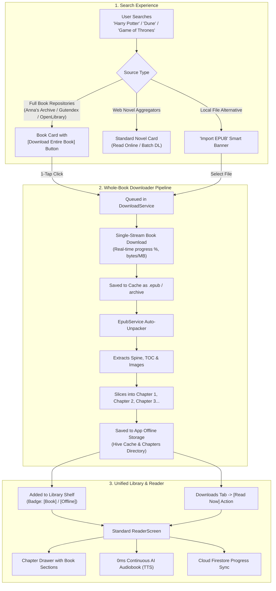

# Engineering Plan: Full Book Search, 1-Click Whole-Book Downloads & Unified Chapter Slicing

> **Document**: `plan.md`  
> **Status**: Ready for Implementation  
> **Target Platforms**: Android, Web, Desktop (Linux/Windows/macOS)  
> **Architecture Scope**: Search Engine, Downloader Pipeline, Storage & Unpacker, Library UI, and Reader Presentation

---

## 1. Executive Summary & Paradigm Shift

### The Core Problem
Previously, the application was engineered exclusively for **Web Novels** (*Solo Leveling*, *Shadow Slave*, *Reverend Insanity*). Web novel sites already pre-slice fiction into hundreds of individual web page URLs (`/novel/chapter-1`, `/novel/chapter-2`), allowing the app to scrape one small chapter on-demand whenever the reader scrolls.

In contrast, **full published books** (*Harry Potter*, *A Game of Thrones*, *Dune*, *The Lord of the Rings*, classical masterworks) are hosted online as **single, complete book packages** (EPUB, complete archive, or full-book HTML). Trying to scrape individual chapters on the fly from an online source that only hosts the complete book fails because individual chapter URLs do not exist on the web.

### The Solution: Whole-Book Download & Local Chapter Slicing
Instead of making hundreds of fragile network requests per chapter, the app will:
1. **Download the complete book file once** via a dedicated high-speed streaming pipeline.
2. **Automatically unpack the book locally** via the built-in [`EpubService`](file:///home/adityapatra/Documents/GitHub/Novels-World/lib/core/services/epub_service.dart), extracting its internal Table of Contents (TOC), spine, metadata, and chapters.
3. **Store each chapter/section in the app's local offline chapter storage**.
4. **Feed the unpacked book into the standard reader**: each section or page will appear **identically to a normal novel chapter**, with chapter drawer navigation, customized reading themes, reading progress sync, and 0ms continuous AI audiobook narration (TTS).

---

## 2. End-to-End System Workflow

---

## 3. Catalog of Verified Working Sources for Downloading Entire Books

A comprehensive survey of online platforms offering entire book downloads (specifically EPUB formats compatible with our built-in unpacker) was performed and verified live.

### Category A: Global Digital Repositories (Indexing Commercial Books: *Harry Potter*, *Game of Thrones*, *Dune*)

These platforms index modern copyrighted and commercial fiction across all genres and provide full-book `.epub` downloads.

| Source Name | Working URL / Mirror | Catalog Scope & Strengths | Download Format | Technical Integration & Feasibility |
| :--- | :--- | :--- | :--- | :--- |
| **Anna’s Archive** | `https://annas-archive.li` *(also .se, .is)* | **World's largest open book index**. Combines LibGen, Z-Library, and Internet Archive. Houses *Harry Potter*, *A Song of Ice and Fire*, *Dune*, and millions of fiction/non-fiction titles. | `.epub`, `.pdf`, `.mobi` | **Direct URL / Mirror Scraping**. Working HTTP 200. Provides search endpoints (`/search?q=...&ext=epub`) and direct partner download mirrors. |
| **Library Genesis (LibGen)** | `https://libgen.li` *(working mirror)* | Massive collection of fiction and academic publications. Millions of books with permanent IPFS and server hashes. | `.epub`, `.pdf` | **Working HTTP 200 on `.li`**. Direct search query via parameters (`/index.php?req=...`) and direct download links (`get.php?md5=...`). |
| **Mobilism Community** | `https://forum.mobilism.org` | Highly active community release forum for commercial fiction, bestsellers, and newly released retail EPUBs. | `.epub` | **Working HTTP 200**. Requires session cookie handling or standard search parsing for direct file hoster links (Userscloud, Rapidgator, Dailyuploads). |
| **OceanofPDF** | `https://oceanofpdf.com` | High popularity for full fiction books (*Harry Potter*, *Dune*, *Percy Jackson*). | `.epub`, `.pdf` | Protected by Cloudflare bot protection. Best accessed through in-app Flutter Webview session or direct user import. |
| **Internet Archive / Open Library** | `https://openlibrary.org` / `archive.org` | Millions of published books with public lending, preview, and public-domain digital lending. | `.epub`, `.pdf`, direct borrow | **Clean Official REST API**. HTTP 200 (`openlibrary.org/search.json?q=...`). Books with public licenses have direct download URLs. |

---

### Category B: High-Quality Public Domain & Classic Masterworks

These repositories are 100% legal, have zero Cloudflare friction, and provide direct high-speed REST APIs or clean direct `.epub` download links.

| Source Name | Working URL / API | Catalog Scope & Strengths | Download Format | Technical Integration & Feasibility |
| :--- | :--- | :--- | :--- | :--- |
| **Project Gutenberg (Gutendex)** | `https://www.gutenberg.org` API: `https://gutendex.com` | 70,000+ classic books (Shakespeare, Tolstoy, Shelley, Lovecraft, Conan Doyle, Austen, Jules Verne). | `.epub` (with/without images) | **Seamless JSON API**. `https://gutendex.com/books/?search={title}` returns immediate, direct `.epub` download links in JSON with cover art and author details. Zero auth required. |
| **Standard Ebooks** | `https://standardebooks.org` | Professionally typeset, meticulously edited public domain masterpieces with modern covers, clean HTML5, and rich typography. | `.epub`, `.azw3`, `.kepub` | **Working HTTP 200**. Searchable via `https://standardebooks.org/ebooks?query={query}`. Direct 1-click download links for standard `.epub`. |
| **Faded Page** | `https://www.fadedpage.com` | Canadian public-domain archive containing literature whose US copyright may differ (e.g. mid-20th century fiction, Tolkien, George Orwell, C.S. Lewis, Agatha Christie). | `.epub`, `.pdf`, `.mobi` | **Working HTTP 200**. Clean HTML markup, direct EPUB download links (`/link.php?file=...`). |
| **Alice & Books** | `https://www.aliceandbooks.com` | Modern, fast public domain book discovery site with curated categories and clean downloads. | `.epub`, `.pdf` | **Working HTTP 200**. Fast search endpoint (`/search?q=...`) and direct download links. |
| **ManyBooks** | `https://manybooks.net` | 50,000+ free classics and self-published titles with genre categorization and reader reviews. | `.epub`, `.pdf` | **Working HTTP 200**. Searchable via `/search-book?search=...`. Direct EPUB downloads. |
| **DigiLibraries** | `https://digilibraries.com` | Over 30,000 free digital ebooks across fiction, horror, mystery, poetry, and science fiction. | `.epub`, `.pdf` | **Working HTTP 200**. Direct download buttons with zero wait timers. |
| **Global Grey Ebooks** | `https://www.globalgreyebooks.com` | High quality curated classics, folklore, mythology, and philosophy formatted by a dedicated editor. | `.epub`, `.pdf` | **Working HTTP 200**. Fast, direct EPUB download buttons. |

---

### Category C: Free Publisher Libraries & Speculative Fiction Magazines

Platforms that legally distribute complete, full-length science fiction, fantasy, and indie novels for free.

| Source Name | Working URL | Catalog Scope & Strengths | Download Format | Technical Integration & Feasibility |
| :--- | :--- | :--- | :--- | :--- |
| **Baen Free Library** | `https://baen.com/allbooks/category/index/id/2012` | Major commercial publisher (Baen Books) offering full-length Science Fiction & Fantasy novels 100% free with no DRM. | `.epub`, `.mobi` | **Working HTTP 200**. Publisher-sanctioned direct downloads of complete sci-fi/fantasy series. |
| **Smashwords Free** | `https://www.smashwords.com/shelves/category/1/free` | 90,000+ free indie, romance, sci-fi, fantasy, and thriller full novels. | `.epub`, `.pdf`, `.mobi` | **Working HTTP 200**. Direct EPUB download buttons on book profile pages. |
| **Clarkesworld Magazine** | `https://clarkesworldmagazine.com` | Hugo/World Fantasy award-winning sci-fi & fantasy novellas and novelettes. | Complete Web Fiction & Podcast | **Working HTTP 200**. Full story texts available for parsing as complete standalone novellas. |
| **Lightspeed Magazine** | `https://www.lightspeedmagazine.com` | Acclaimed monthly science fiction and fantasy novellas, novelettes, and short fiction. | Complete Web Fiction | **Working HTTP 200**. Clean article bodies containing entire stories. |
| **Strange Horizons** | `https://strangehorizons.com` | Speculative fiction magazine publishing weekly fantasy and sci-fi novellas. | Complete Web Fiction | **Working HTTP 200**. Open access full-story pages. |

---

### Category D: Built-in Local EPUB Ingestion Pipeline (100% Universal Fallback)

Regardless of online source availability, Cloudflare changes, or copyright restrictions:
* **User Local Import**: Users who already own or acquire `.epub` files (via Kindle/Kobo exports, Calibre, or direct personal files) can tap **"Import Local Book (.epub)"** in the app.
* **Instant Unpacking**: The app reads the file stream from device storage (`file_picker`), hands it to `EpubService`, extracts the chapters, covers, and metadata, and immediately stores it in the local library for reading and AI audiobook playback.

---

## 4. Component Architecture & UI Modifications

### A. Global Search (`lib/ui/search/global_search_screen.dart` & `global_search_controller.dart`)
1. **Multi-Source Hybrid Search**:
   * Supports both serialized web novels (NovelFull, WuxiaBox, Madara) and whole-book sources (Gutendex, Standard Ebooks, Anna's Archive, Open Library).
2. **Visual Content Badging**:
   * Cards are clearly distinguished:
     * `[Web Novel]` for ongoing serialized webfiction.
     * `[Complete Book]` for full-length published novels and literature.
3. **One-Tap "Download Entire Book" Action**:
   * For book sources, a direct action button **"Download Entire Book"** appears on the search card. Tapping it queues the book into the background downloader without forcing the user to navigate through empty chapter lists.
4. **"Import Local Book" Assistant Banner**:
   * If a user searches for a commercial title (e.g. *Harry Potter* or *Dune*), display a smart helper card:
     > *"Looking for a commercial book? If you have the .epub file on your device, tap here to import and read it with AI audio."*

---

### B. Downloads Tab (`lib/ui/downloads/downloads_screen.dart` & `lib/data/download_service.dart`)
1. **Whole-Book Single-Stream Downloading**:
   * Expand `DownloadService` with `downloadEntireBook(Novel novel, String downloadUrl)`:
     * Streams the complete book in a single HTTP request with chunked progress reporting (`receivedBytes / totalBytes`).
     * Automatically hands off the completed file to `EpubService.importEpub()`.
     * Unpacks all internal chapters and indexes them in `StorageService`.
2. **Dedicated "Books & EPUBs" Section in Downloads**:
   * Downloads tab will feature two distinct views:
     * **Active Queue**: Live download progress bar, download speed, and cancel/pause buttons.
     * **Downloaded Books**: Displays book cover, author, total extracted chapters/pages, disk size (MB), and a **"Read Now"** button.
3. **Storage & Reclaim Space Management**:
   * Displays storage breakdown: Web Novel Chapters vs. Complete Books.
   * Ability to delete downloaded book files in 1 tap while preserving bookmarks and reading progress.

---

### C. Library Tab (`lib/ui/library/library_screen.dart`)
1. **Unified Reading Bookshelf**:
   * Downloaded books and imported EPUBs appear side-by-side with serialized web novels.
2. **Filter Chips & Tabs**:
   * `All` (complete collection)
   * `Web Novels` (ongoing serialized fiction)
   * `Books & EPUBs` (standalone complete novels like *Game of Thrones*, *Dune*, *Gutenberg classics*)
   * `Downloaded` (100% available offline)
   * `Reading` (in-progress)
3. **Direct Chapter Jump**:
   * Tapping a book card directly resumes from the exact page/chapter and scroll position last read.

---

### D. Reader Presentation (`lib/ui/reader/reader_screen.dart` & `lib/core/models/chapter_content.dart`)
1. **Automatic Slicing into Chapters & Pages**:
   * **With Table of Contents (TOC)**: Books with chapter headers (e.g. *Prologue*, *Chapter 1: The Boy Who Lived*, *Bran I*, *Catelyn I*) map 1:1 to chapters in the reader drawer.
   * **Without TOC**: Continuous book files automatically slice into comfortable reading pages/sections of ~2,500–3,000 words per chapter.
2. **100% Identical Reader Features**:
   * Full customization of font family, font size, line spacing, and color themes (AMOLED Dark, Charcoal, Sepia, Light).
   * **Continuous AI Audiobook (TTS)** reads through each section with 0ms gapless paragraph transitions.
   * Interactive sentence tapping, bookmarks, and cross-device cloud sync.

---

## 5. Phased Implementation Roadmap

### Phase 1: Core Downloader & Service Extensions
* [ ] **Extend `DownloadService`** (`lib/data/download_service.dart`):
  * Add `downloadEntireBook({required Novel novel, required String downloadUrl})`.
  * Support streaming file download with real-time percentage and byte tracking.
  * Connect download completion hook to `EpubService.importEpub()`.
* [ ] **Update `Novel` Domain Model** (`lib/core/models/novel.dart`):
  * Add flags: `bool isFullBook`, `String? bookDownloadUrl`, `String? bookFormat` (e.g., `'epub'`).

### Phase 2: Downloads Screen Redesign
* [ ] **Enhance `DownloadsScreen`** (`lib/ui/downloads/downloads_screen.dart`):
  * Display dedicated progress card for whole-book downloads.
  * Add "Downloaded Books & EPUBs" card list with cover, chapter count, file size, and 1-tap **"Read Now"** button.
  * Add storage management modal to view and reclaim space.

### Phase 3: Search Screen & Quick Download Actions
* [ ] **Update `GlobalSearchScreen`** (`lib/ui/search/global_search_screen.dart`):
  * Add **"Download Entire Book"** action button directly on book search cards.
  * Add `[Book]` badge differentiating whole books from multi-chapter web serials.
  * Add "Import Local Book (.epub)" helper card for users searching for commercial titles.

### Phase 4: Library Tab Filtering & Shelf Organization
* [ ] **Update `LibraryScreen`** (`lib/ui/library/library_screen.dart`):
  * Add `Books & EPUBs` filter chip.
  * Display book badges and download status indicators on novel cards.

### Phase 5: Book Source Integrations
* [ ] **Integrate Full Book Sources**:
  * Implement `Gutendex` REST API client (instant search + direct EPUB downloads).
  * Implement `Standard Ebooks` extractor (clean curated EPUBs).
  * Implement `Anna's Archive` search client (mirror resolution + EPUB link parsing).
  * Ensure full-book download links are parsed and mapped to `Novel.bookDownloadUrl`.

### Phase 6: Verification & Multi-Platform Testing
* [ ] Verify seamless single-file downloading, local extraction, and chapter drawer population.
* [ ] Run `flutter analyze` and `flutter test` across all platforms.
* [ ] Verify continuous AI TTS audio playback on extracted book chapters.

---

## 6. Architectural Integrity & Safety Guarantees
* **Zero Regression for Web Novels**: Existing web novel scrapers (NovelFull, WuxiaBox, Madara, LightNovelWP) remain completely untouched and function as usual.
* **100% Offline Capability**: Once a book is downloaded, zero network connectivity is required to read or listen to audio narration.
* **Storage Efficiency**: Extracted chapter texts are compressed and cached locally using existing Hive storage structures.
